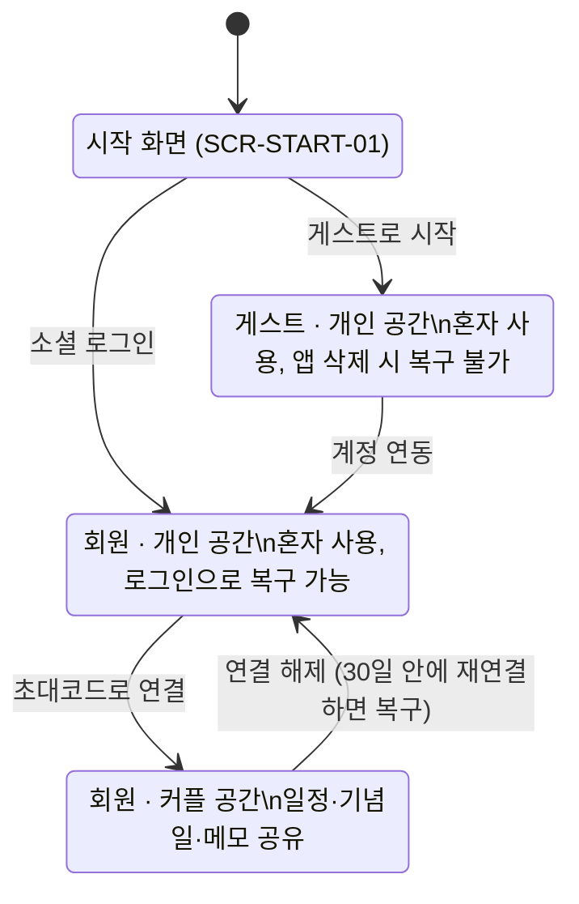

# 둘이서 PRD (MVP v0.1.0)

> 문서 버전: 0.3 (2026-10-17)
> 원본: 이 파일(`docs/PRD.md`)이 단일 기준이다. [Claude Docs 판](https://claude.ai/code/artifact/86a4d6fa-c38c-454c-910d-1cfaf6c6345d)은 v0.3 시점의 사본이며 더 이상 갱신하지 않는다.
> 함께 보는 문서: `ERD.md`, `ERD.png`, `API.md`, `SCREENS.md`

---

## 0. 이 문서를 읽는 법

이 PRD는 둘이서 MVP(v0.1.0)의 단일 기준 문서다. 사람과 AI 에이전트가 같은 뜻으로 읽도록, 모든 항목에 ID를 붙이고 수용 기준을 검증 가능한 형태로 쓴다.

| 접두어 | 의미 | 예 |
| --- | --- | --- |
| D- | 결정 기록 | D-07 |
| SCR- | 화면 | SCR-CAL-01 |
| FR- | 기능 요구사항 | FR-MEMO-05 |
| FR-…ACn | 수용 기준 | FR-MEMO-05.AC2 |
| NFR- | 비기능 요구사항 | NFR-SEC-01 |
| Q- | 확인 필요 사항 | Q-01 |

**해석 규칙 (에이전트 필수)**

1. 이 문서에 없는 기능은 만들지 않는다. "범위 밖"에 있는 기능은 PRD가 수정되기 전까지 구현하지 않는다.
2. 내용이 충돌하면 우선순위는 결정 기록(D) > 권한 매트릭스 > 기능 요구사항(FR) > 화면 목록(SCR) 순이다.
3. "기본값"으로 표시된 결정은 확정과 똑같이 구현한다. 나중에 바뀔 수 있다는 표시일 뿐이다.
4. 확인 필요 사항(Q)에 기본값이 있으면 기본값으로 구현하고, 기본값이 없으면 추측하지 말고 작업을 멈춘 뒤 보고한다.
5. 수용 기준은 Given / When / Then 형식이며 그대로 테스트 케이스가 된다. 커밋, PR, 테스트 이름에 FR ID를 쓴다 (예: `FR-MEMO-05.AC2`).
6. 용어는 용어집의 뜻으로만 쓴다.

---

## 1. 제품 개요

**둘이서는 혼자서도, 커플이 함께도 쓰는 일정·메모 앱이다.** 혼자 쓰다가 상대를 초대하면 같은 캘린더와 메모장을 공유한다.

- **대상 사용자**: 연인과 일정·메모를 공유하려는 사람, 그리고 아직 상대 없이 혼자 기록하려는 사람
- **플랫폼**: Android (MVP). iOS는 다음 버전 (D-25)
- **서버**: Kotlin + Spring Boot + PostgreSQL

**핵심 가치**

1. 가입 없이 바로 시작: 게스트로 시작하고, 필요할 때 Google·Kakao로 연동한다.
2. 함께 보는 일정: 둘의 일정과 기념일이 한 캘린더에 모이고, 캘린더가 첫 화면이다.
3. 공지가 되는 메모: 따로 공지 게시판 없이, 메모를 고정하면 그게 공지가 된다.

**MVP 완료 기준**: 두 사람이 각자의 Android 기기에서 커플로 연결하고, 일정·기념일·메모를 만들면 상대 화면에 반영된다. 이 문서의 모든 FR 수용 기준이 테스트를 통과한다. 정량 목표(사용자 수 등)는 미정이다 (Q-02).

---

## 2. 용어집

아래 용어는 이 문서와 코드, UI 문구에서 이 뜻으로만 쓴다. 영문명은 코드 식별자 기준이다.

| 용어 | 영문명 | 정의 |
| --- | --- | --- |
| 사용자 | User | 앱을 쓰는 한 사람. 게스트 또는 회원이다 |
| 게스트 | Guest | 소셜 로그인 없이 시작한 사용자. 서버에 UUID로 식별되는 계정이 있지만, 앱 삭제나 기기 변경 시 복구할 수 없다 |
| 회원 | Member | Google 또는 Kakao 계정으로 로그인했거나 연동한 사용자. 같은 소셜 계정으로 다시 로그인하면 데이터가 복구된다 |
| 계정 연동 | Account linking | 게스트가 소셜 계정을 연결해 회원이 되는 것. 계정은 그대로이고 데이터도 유지된다 |
| 공간 | Space | 일정, 기념일, 메모가 속하는 단위. 사용자는 항상 공간 하나에 속한다 |
| 개인 공간 | Personal space | 커플 연결 전 사용자 혼자 쓰는 공간 |
| 커플 공간 | Couple space | 연결된 두 사용자가 함께 쓰는 공간. 연결되면 각자의 개인 공간 대신 이 공간을 쓴다 |
| 커플 연결 | Couple link | 두 회원이 초대코드로 커플 공간을 만드는 것. 한 사용자는 동시에 한 커플에만 속한다 |
| 초대코드 | Invite code | 커플 연결용 1회용 코드. 만든 지 24시간 뒤 만료된다 |
| 연결 해제 | Unlink | 커플 연결을 끊는 것. 커플 공간은 유예 기간 동안 보관된다 |
| 유예 기간 | Grace period | 연결 해제 후 커플 공간을 보관하는 30일. 이 안에 같은 두 사람이 재연결하면 복구된다 |
| 작성자 | Author | 일정, 기념일, 메모를 처음 만든 사용자 |
| 상대 | Partner | 같은 커플 공간에 속한 다른 한 사용자 |
| 일정 | Event | 캘린더에 표시되는 항목. 반복하지 않는다 |
| 일정 메모 | Event note | 일정 안의 자유 텍스트 칸. 메모장의 메모와 다르다 |
| 일정 알림 | Event reminder | 사용자가 일정에 각자 설정하는 푸시 알림. 상대에게 공유되지 않는다 |
| 사귄 날 | Start date | 커플이 사귀기 시작한 날. 이 날을 1일로 계산한다 |
| D-day | D-day | 사귄 날부터 오늘까지의 일수 (D+N) |
| 기념일 | Anniversary | 자동 기념일과 직접 기념일을 합친 말 |
| 자동 기념일 | Auto anniversary | 사귄 날로 자동 계산되는 기념일 (100일 단위, 매년) |
| 직접 기념일 | Custom anniversary | 사용자가 직접 등록한 기념일 (생일 등). 매년 반복할 수 있다 |
| 메모 | Memo | 메모장 탭의 항목. 제목, 본문, 체크리스트로 이뤄진다 |
| 체크리스트 | Checklist | 메모 안의 체크 가능한 항목 목록 |
| 고정 핀 | Pin | 메모를 목록 맨 위 공지 영역에 고정하는 것. 커플 공간에서는 상대에게도 보인다 |
| 즐겨찾기 | Favorite | 사용자가 각자 메모에 표시하는 것. 상대에게 보이지 않는다 |
| 사람 색 | Person color | 일정이 누구의 것인지 나타내는 색. 나·상대·함께 세 가지이며 커플이 '우리 색상'에서 고른다 |
| 일정 대상 | Event target | 일정이 누구의 것인지: 특정 사용자 한 명 또는 '함께'. 화면에는 보는 사람 기준으로 나·상대·함께로 표시한다. 작성할 때는 나 또는 함께만 고를 수 있다 (D-34). 개인 공간에서는 항상 나 |
| 우리 색상 | Our colors | 커플 공간의 사람 색 설정. 두 사람이 함께 쓰는 값이다 |
| 프로필 | Profile | 사용자의 이름(닉네임)과 사진. 상대에게 보인다 |

---

## 3. 범위

MVP는 계정, 커플 연결, 캘린더, 기념일, 메모, 알림 여섯 영역이다. 아래 "범위 밖"은 요청이 있어도 PRD 수정 없이 만들지 않는다.

**MVP 포함**

| 영역 | 기능 | FR |
| --- | --- | --- |
| 계정 | 게스트 시작, Google·Kakao 로그인, 게스트→회원 연동, 로그아웃, 탈퇴, 프로필(이름·사진) | FR-AUTH |
| 커플 | 초대코드 생성·입력, 연결, 기록 가져오기, 연결 해제, 유예 기간 내 복구 | FR-COUPLE |
| 캘린더 | 월간 보기(첫 화면), 일정 작성·수정·삭제, 일정 대상(나·함께), 사람 색(우리 색상), 일정 메모, 일정 알림 | FR-CAL |
| 기념일 | D-day, 자동 기념일, 직접 기념일, 기념일 알림 | FR-ANNIV |
| 메모 | 작성·수정·삭제, 체크리스트, 고정 핀, 즐겨찾기, 정렬·보기 | FR-MEMO |
| 알림·설정 | 푸시 알림, 알림 종류별 켜고 끄기, 설정 화면 | FR-NOTI, FR-SET |

**범위 밖 (MVP에서 만들지 않음)**

- iOS 앱, 웹 버전
- Naver 등 Google·Kakao 외 로그인
- 반복 일정 (기념일의 매년 반복만 예외)
- 일정 장소, 지도 연동, 외부 캘린더(Google 캘린더 등) 연동
- 메모 이미지 첨부, 태그, 검색
- 상대가 만든 메모·일정 내용 수정 (체크 표시와 '함께' 일정은 예외, D-22, D-12)
- 실시간 연결(WebSocket), 오프라인 작성·수정
- 채팅, 위젯, 데이터 내보내기
- 한 사용자가 여러 커플에 속하거나, 셋 이상이 한 공간을 쓰는 것

---

## 4. 사용자 상태 모델

사용자는 항상 아래 상태 중 하나다. 데이터는 공간에 속하므로(D-29), 상태가 바뀌면 보이는 공간이 바뀐다. 게스트는 연동해야 회원이 되고, 회원만 커플이 된다.

1. 시작 → 게스트·개인 공간: "게스트로 시작" (FR-AUTH-01)
2. 시작 → 회원: 소셜 로그인. 신규면 회원·개인 공간, 기존 회원이면 그 계정의 현재 상태로 들어간다 (FR-AUTH-02)
3. 게스트·개인 공간 → 회원·개인 공간: 계정 연동 (FR-AUTH-03)
4. 회원·개인 공간 → 회원·커플 공간: 초대코드로 연결 (FR-COUPLE-02)
5. 회원·커플 공간 → 회원·개인 공간: 연결 해제, 커플 공간은 30일 보관 (FR-COUPLE-05, FR-COUPLE-06)
6. 모든 상태 → 시작 화면: 회원의 로그아웃과 탈퇴, 게스트의 앱 삭제·기기 변경 (게스트는 복구 불가)

---

## 5. 화면 목록

하단 탭은 캘린더와 메모 두 개이고, 앱의 첫 화면은 캘린더다 (D-30). 설정, 기념일, 커플 연결은 탭이 아니라 화면 상단에서 들어간다. 정확한 배치는 디자인 단계에서 정한다.

| 화면 ID | 화면 | 진입 | 비고 |
| --- | --- | --- | --- |
| SCR-START-01 | 시작 | 첫 실행, 로그아웃 후 | Google, Kakao, 게스트로 시작 |
| SCR-CAL-01 | 캘린더 홈 | 앱 진입 기본 화면, 하단 탭 | 월간 달력 + 선택한 날의 일정 목록, 커플이면 상단에 D-day |
| SCR-CAL-02 | 일정 상세 | 일정 선택 | 작성자에게만 수정·삭제 노출, 내 일정 알림 설정 |
| SCR-CAL-03 | 일정 작성·수정 | 캘린더의 추가 버튼, 상세의 수정 | |
| SCR-ANNIV-01 | 기념일 목록 | 캘린더 상단 D-day 또는 기념일 진입점 | 자동 + 직접 기념일, 다가오는 순 |
| SCR-ANNIV-02 | 직접 기념일 작성·수정 | 기념일 목록의 추가 버튼 | |
| SCR-MEMO-01 | 메모 목록 | 하단 탭 | 상단 고정 영역(최대 3개 + 더보기), 정렬·보기 선택 |
| SCR-MEMO-02 | 고정 메모 전체 | 메모 목록의 "더보기" | 고정 메모가 4개 이상일 때만 진입점 노출 |
| SCR-MEMO-03 | 메모 상세 | 메모 선택 | 체크리스트 체크, 고정, 즐겨찾기 |
| SCR-MEMO-04 | 메모 작성·수정 | 메모 목록의 추가 버튼, 상세의 수정 | |
| SCR-COUPLE-01 | 커플 연결 | 회원 첫 로그인 직후, 설정 | "초대코드 만들기" / "초대코드 입력하기" 두 버튼 + "혼자 시작하기" |
| SCR-COUPLE-02 | 초대코드 만들기 | SCR-COUPLE-01 | 코드, 남은 시간, 공유, 재발급 |
| SCR-COUPLE-03 | 초대코드 입력하기 | SCR-COUPLE-01 | |
| SCR-COUPLE-04 | 연결 완료 | 연결 성공 직후 (양쪽 모두) | 사귄 날 입력, 기존 기록 가져오기 확인 |
| SCR-SET-01 | 전체 메뉴 (설정) | 캘린더 상단 햄버거 메뉴 | 프로필(이름·사진), 우리 색상, 계정 연동, 커플 관리, 알림 설정, 로그아웃, 탈퇴 |
| SCR-SET-02 | 알림 설정 | SCR-SET-01 | 알림 종류별 켜고 끄기 |
| SCR-SET-03 | 우리 색상 | SCR-SET-01 | 나·상대·함께 색을 12색 중 선택, 캘린더 미리보기, 같은 색 경고 |
| SCR-SET-04 | 프로필 수정 | SCR-SET-01 | 이름, 사진 변경 (사진 선택 시트: 앨범, 카메라, 삭제) |

---

## 6. 기능 요구사항

각 FR은 설명 한 줄과 수용 기준(AC)으로 이뤄진다. 권한은 7장 권한 매트릭스를 따른다.

### 6.1 계정 (FR-AUTH)

**FR-AUTH-01 게스트로 시작** (D-01, D-02)

- AC1: Given 앱을 처음 실행한 사용자, When "게스트로 시작"을 누르면, Then 서버에 UUID로 식별되는 게스트 계정과 개인 공간이 만들어지고 SCR-CAL-01로 이동한다.
- AC2: Given 게스트로 시작한 적이 있는 기기, When 앱을 다시 실행하면, Then 저장된 인증 정보로 같은 게스트 계정에 자동으로 들어간다.
- AC3: Given 게스트가 앱을 삭제했거나 기기를 바꾼 상황, When 앱을 새로 설치해 실행하면, Then 이전 게스트 계정에 접근할 방법은 없고 SCR-START-01이 표시된다.

**FR-AUTH-02 소셜 로그인** (D-01, D-03)

- AC1: Given 가입한 적 없는 Google 또는 Kakao 계정, When 로그인하면, Then 회원 계정과 개인 공간이 만들어지고 SCR-COUPLE-01이 표시된다.
- AC2: Given 이미 회원인 소셜 계정, When 다른 기기나 재설치한 앱에서 로그인하면, Then 그 계정이 속한 공간의 데이터가 그대로 보인다.

**FR-AUTH-03 게스트 → 회원 연동** (D-03)

- AC1: Given 게스트, When 설정에서 Google 또는 Kakao 연동을 완료하면, Then 같은 계정이 회원으로 바뀌고 기존 일정·기념일·메모가 모두 유지된다.
- AC2: Given 연동하려는 소셜 계정이 이미 다른 회원 계정에 쓰이고 있음, When 연동을 시도하면, Then 연동하지 않고 "이미 가입된 계정"임을 안내한다. 두 계정의 데이터는 합치지 않는다 (Q-01, 기본값).

**FR-AUTH-04 게스트 데이터 안내** (D-09)

- AC1: Given 게스트, When SCR-SET-01을 열면, Then 상단에 "앱을 삭제하거나 기기를 바꾸면 데이터를 복구할 수 없습니다" 안내와 계정 연동 버튼이 항상 보인다.
- AC2: Given 게스트, When 커플 연결 메뉴를 누르면, Then 연결 화면 대신 계정 연동이 필요하다는 안내와 연동 버튼이 표시된다 (D-07).

**FR-AUTH-05 로그아웃**

- AC1: Given 회원, When 로그아웃을 확인하면, Then 기기의 인증 정보와 캐시가 지워지고 SCR-START-01로 이동한다. 서버 데이터는 그대로다.
- AC2: Given 게스트, When 설정을 열면, Then 로그아웃 메뉴는 보이지 않는다 (로그아웃하면 다시 들어올 방법이 없으므로).

**FR-AUTH-06 탈퇴** (Google Play 정책상 필수)

- AC1: Given 개인 공간의 사용자(게스트 포함), When 탈퇴를 최종 확인하면, Then 계정과 개인 공간의 모든 데이터가 즉시 삭제되고 SCR-START-01로 이동한다.
- AC2: Given 커플 공간의 사용자, When 탈퇴를 최종 확인하면, Then 먼저 연결 해제(FR-COUPLE-05)가 처리된 뒤 계정이 삭제된다. 커플 공간은 장애 복구를 위해 서버에 90일간 보관한 뒤 영구 삭제한다. 보관 중인 데이터는 어떤 사용자에게도 보이지 않고 운영자만 복구할 수 있다 (D-36).

**FR-AUTH-07 프로필 (이름·사진)**

- AC1: Given 소셜 로그인으로 가입한 회원, When 가입이 완료되면, Then 소셜 프로필 이름이 닉네임 기본값이 된다. 게스트의 기본 닉네임은 "게스트"다.
- AC2: Given 사용자, When 설정에서 닉네임을 바꾸면, Then 상대 화면의 작성자 표시에도 바뀐 닉네임이 보인다.
- AC3: Given 사용자, When SCR-SET-04에서 앨범이나 카메라로 사진을 골라 저장하면, Then 프로필 사진이 바뀌고 상대 화면의 아바타에도 보인다 (D-33).
- AC4: Given 프로필 사진이 없는 사용자, Then 아바타는 사람 색 배경에 '나' 또는 '너' 글자로 표시된다.
- AC5: Given 사진을 삭제함, Then 서버의 사진 파일도 삭제되고 AC4의 표시로 돌아간다 (NFR-FILE-01).

### 6.2 커플 연결 (FR-COUPLE)

**FR-COUPLE-01 초대코드 만들기** (D-05)

- AC1: Given 개인 공간의 회원, When SCR-COUPLE-02에 들어가면, Then 8자리 초대코드(영문 대문자와 숫자, 0·O·1·I 제외)와 남은 유효 시간이 표시되고 공유 버튼으로 코드를 보낼 수 있다.
- AC2: Given 만든 지 24시간이 지난 코드, When 상대가 입력하면, Then "만료된 코드"로 거부된다.
- AC3: Given 유효한 코드가 있는 회원, When 재발급하면, Then 기존 코드는 즉시 무효가 되고 새 코드가 표시된다.

**FR-COUPLE-02 초대코드 입력하기**

- AC1: Given 개인 공간의 회원 B와 유효한 코드를 가진 회원 A, When B가 A의 코드를 입력하면, Then 커플 공간이 만들어지고 두 사람 모두 SCR-COUPLE-04로 이동하며 코드는 사용 처리된다.
- AC2: Given 존재하지 않는 코드, 만료된 코드, 이미 사용된 코드, 자신이 만든 코드, When 입력하면, Then 각각 구분된 오류 문구로 거부된다.
- AC3: Given 코드를 만든 A가 그 사이 다른 사람과 연결됨, When B가 A의 코드를 입력하면, Then "사용할 수 없는 코드"로 거부된다.
- AC4: Given 한 사용자, When 1시간 안에 잘못된 코드를 10번 입력하면, Then 1시간 동안 입력이 막힌다 (NFR-SEC-03).

**FR-COUPLE-03 연결 시 기존 기록 가져오기** (D-08)

- AC1: Given 연결 직후 개인 공간에 일정·기념일·메모가 있는 사용자, When SCR-COUPLE-04에서 "가져오기"를 고르면, Then 그 데이터가 작성자 정보를 유지한 채 커플 공간으로 옮겨진다.
- AC2: Given 같은 상황, When "가져오지 않기"를 고르면, Then 개인 공간의 데이터는 삭제된다. 삭제 전 이 결과를 한 번 더 확인받는다.
- AC3: 두 사람은 각자 자신의 데이터에 대해서만 고른다.

**FR-COUPLE-04 사귄 날 입력**

- AC1: Given 연결된 커플, When 둘 중 누구든 SCR-COUPLE-04 또는 설정에서 사귄 날을 입력하거나 수정하면, Then D-day와 자동 기념일이 다시 계산되어 두 사람 모두에게 반영된다 (Q-07).
- AC2: Given 사귄 날이 없는 커플, When SCR-CAL-01을 열면, Then D-day 자리에 사귄 날 입력 안내가 보인다.

**FR-COUPLE-05 연결 해제** (D-06)

- AC1: Given 커플 공간의 사용자, When 설정에서 연결 해제를 최종 확인하면, Then 두 사람 모두 커플 공간에서 나가고 각자 빈 개인 공간에서 다시 시작하며, 상대에게 해제 알림이 간다 (D-37).
- AC2: Given 해제된 커플 공간, When 해제 후 30일이 지나면, Then 커플 공간과 그 안의 모든 데이터가 영구 삭제된다.
- AC3: Given 연결이 해제된 두 사람(해제한 사람과 상대 모두), When 앱이 해제를 알게 되면(해제 직후, 해제 푸시 수신, 또는 다음 실행 시), Then 앱은 로그인 정보를 뺀 기기의 데이터(캐시, 화면 상태 등)를 모두 지우고 재시작해 자동 로그인한 뒤 SCR-COUPLE-01(연결 방법 선택)로 이동한다. 서버의 프로필과 알림 설정은 유지된다 (D-37).

**FR-COUPLE-06 유예 기간 내 복구** (D-06)

- AC1: Given 해제 후 30일이 지나지 않은 두 사람, When 둘이 다시 초대코드로 연결하면, Then 새 커플 공간 대신 이전 커플 공간이 복구된다.
- AC2: Given 해제 후 각자 개인 공간에 새로 만든 데이터, When 복구되면, Then FR-COUPLE-03과 같은 방식으로 가져올지 고른다.

### 6.3 캘린더 (FR-CAL)

**FR-CAL-01 캘린더 홈** (D-30)

- AC1: Given 로그인된 사용자, When 앱을 열면, Then SCR-CAL-01이 오늘이 속한 달로 표시되고 오늘 날짜가 선택되어 있다.
- AC2: Given 일정이나 기념일이 있는 날, When 월간 달력을 보면, Then 그 날에 표시가 있고, 날짜를 누르면 아래 목록에 그 날의 기념일과 일정이 시작 시간순으로 보인다 (종일 일정과 기념일이 먼저).
- AC3: Given 커플이고 사귄 날이 있음, When SCR-CAL-01을 열면, Then 상단에 D+N이 보인다 (FR-ANNIV-01).

**FR-CAL-02 일정 작성** (D-10)

- AC1: Given 사용자, When 제목, 시작 일시, 종료 일시를 입력하고 저장하면, Then 일정이 현재 공간에 만들어진다. 제목은 필수다.
- AC2: Given 종일을 켠 일정, When 저장하면, Then 시간 없이 시작일과 종료일만 저장된다.
- AC3: Given 종료 일시가 시작 일시보다 이른 입력, When 저장하면, Then 저장되지 않고 오류가 표시된다.
- AC4: 일정 대상(나 또는 함께, 기본은 나. 상대는 고를 수 없음, D-34), 일정 메모, 일정 알림은 선택 항목이다. 개인 공간에서는 대상 선택이 보이지 않고 항상 나다. 일정의 색은 대상의 사람 색을 따른다 (FR-CAL-04).
- AC5: 여러 날에 걸친 일정은 시작일부터 종료일까지 모든 날짜에 표시된다.

**FR-CAL-03 일정 수정·삭제** (D-12)

- AC1: Given 내가 만든 일정, When SCR-CAL-02를 열면, Then 수정과 삭제를 할 수 있다.
- AC2: Given 상대가 만든 일정 중 대상이 '함께'가 아닌 것, When SCR-CAL-02를 열면, Then 수정·삭제 메뉴가 보이지 않는다. 서버도 작성자가 아닌 사용자의 수정·삭제 요청을 거부한다 (NFR-SEC-02).
- AC3: SCR-CAL-02에는 작성자 닉네임이 표시된다.
- AC4: Given 대상이 '함께'인 일정, Then 작성자와 상대 모두 수정·삭제할 수 있다 (D-12).
- AC5: 대상이 '함께'가 아닌 일정은 작성자 본인의 일정이므로 작성자만 수정·삭제한다 (D-34).

**FR-CAL-04 사람 색 (우리 색상)** (D-15)

- AC1: Given 커플 공간, Then 색은 사람 색 세 가지(두 사용자 각각, 함께)로 정해지고 일정은 대상의 색으로 표시된다. 일정마다 색을 고르지 않는다.
- AC2: Given 커플의 누구든, When SCR-SET-03에서 12색 팔레트 중 각 사람 색과 함께 색을 바꾸면, Then 두 사람 화면에 모두 반영된다. 화면에는 보는 사람 기준으로 나·상대·함께로 표시된다.
- AC3: 기본값은 초대코드를 만든 사람 주황, 입력한 사람 파랑, 함께 보라다 (앱 아이콘 색).
- AC4: Given 두 대상이 같은 색, When 저장하면, Then 저장되지만 같은 색이라는 경고 배너가 보인다.
- AC5: Given 개인 공간, Then 사람 색은 나 하나뿐이고 기본은 주황이다.
- AC6: 사람 색은 색만으로 의미를 전달하지 않는다. 항상 라벨(나·상대·함께)이나 아바타 글자와 함께 표시한다.

**FR-CAL-05 일정 알림** (D-16)

- AC1: Given 아무 일정(상대의 일정 포함), When 사용자가 알림을 "없음, 정시, 10분 전, 1시간 전, 1일 전" 중 하나로 고르면, Then 그 사용자에게만 해당 시각에 푸시가 온다.
- AC2: Given 사용자 A가 일정에 알림을 설정함, When 상대 B가 같은 일정을 보면, Then B에게는 A의 알림 설정이 보이지 않고 B의 설정만 보인다.
- AC3: Given 종일 일정, When 알림을 고르면, Then 선택지는 "없음, 당일 오전 9시, 1일 전 오전 9시"다.
- AC4: Given 알림이 설정된 일정, When 작성자가 일시를 바꾸면, Then 모든 사용자의 알림 시각이 새 일시 기준으로 다시 계산된다.

### 6.4 기념일 (FR-ANNIV)

**FR-ANNIV-01 D-day** (D-14, D-23)

- AC1: Given 사귄 날이 2026-01-01인 커플, When 2026-01-01에 SCR-CAL-01을 열면, Then D+1이 표시된다 (사귄 날 = 1일).
- AC2: Given 개인 공간의 사용자, Then D-day는 표시되지 않는다.

**FR-ANNIV-02 자동 기념일** (D-20, D-23)

- AC1: Given 사귄 날이 있는 커플, Then 100일, 200일 … 1000일과 매년 N주년이 자동 기념일로 계산되어 캘린더와 SCR-ANNIV-01에 표시된다.
- AC2: Given 사귄 날이 2026-01-01, Then 100일은 2026-04-10이고, 1주년은 2027-01-01이다.
- AC3: 자동 기념일은 수정·삭제할 수 없다. 사귄 날을 바꾸면 다시 계산된다.

**FR-ANNIV-03 직접 기념일** (D-20)

- AC1: Given 사용자(개인·커플 공간 모두), When 이름과 날짜를 입력하고 "매년 반복"을 켜거나 끄고 저장하면, Then 직접 기념일이 만들어지고 캘린더와 목록에 표시된다.
- AC2: 직접 기념일의 수정·삭제는 작성자만 할 수 있다 (D-12와 같은 규칙).
- AC3: Given 2월 29일에 매년 반복하는 기념일, When 윤년이 아닌 해이면, Then 2월 28일에 표시된다.

**FR-ANNIV-04 기념일 목록**

- AC1: Given 사용자, When SCR-ANNIV-01을 열면, Then 오늘 이후의 기념일이 가까운 순으로 보이고, 각 항목에 남은 일수(D-N)가 표시된다.

### 6.5 메모 (FR-MEMO)

**FR-MEMO-01 메모 목록**

- AC1: Given 사용자, When SCR-MEMO-01을 열면, Then 고정되지 않은 메모가 작성일 기준 최신순으로 보인다.
- AC2: Given 보기 선택, When "오래된순"을 고르면 작성일 오래된순, "즐겨찾기"를 고르면 내가 즐겨찾기한 메모만 최신순으로 보인다.
- AC3: 각 항목에는 제목(없으면 본문 첫 줄), 작성자 닉네임, 작성일, 체크리스트 진행(예: 2/5)이 보인다.

**FR-MEMO-02 메모 작성** (D-19)

- AC1: Given 사용자, When 제목, 본문, 체크리스트 항목 중 하나 이상을 입력하고 저장하면, Then 메모가 현재 공간에 만들어진다.
- AC2: Given 셋 다 비어 있음, When 저장하면, Then 저장되지 않는다.

**FR-MEMO-03 메모 수정·삭제** (D-17)

- AC1: Given 내가 만든 메모, Then 제목, 본문, 체크리스트 항목을 수정하고 메모를 삭제할 수 있다.
- AC2: Given 상대가 만든 메모, Then 수정·삭제 메뉴가 보이지 않는다. 서버도 거부한다 (NFR-SEC-02).

**FR-MEMO-04 체크리스트** (D-19, D-22)

- AC1: Given 작성자, Then 체크리스트 항목을 추가, 수정, 삭제, 순서 변경할 수 있다.
- AC2: Given 같은 공간의 누구든(작성자와 상대), When 항목의 체크를 누르면, Then 체크 상태가 바뀌고 두 사람 모두에게 반영된다. 항목 내용은 바뀌지 않는다.

**FR-MEMO-05 고정 핀** (D-18, D-21)

- AC1: Given 같은 공간의 누구든, When 아무 메모나 고정하거나 해제하면, Then 두 사람의 목록에 모두 반영된다. 고정 개수에는 제한이 없다.
- AC2: Given 고정된 메모가 3개 이하, When SCR-MEMO-01을 열면, Then 목록 맨 위 고정 영역에 모두 보이고 "더보기"는 없다.
- AC3: Given 고정된 메모가 4개 이상, When SCR-MEMO-01을 열면, Then 고정 영역에 가장 최근에 고정한 3개만 보이고 "더보기"가 나타나며, 누르면 SCR-MEMO-02에서 전체가 최근 고정순으로 보인다.
- AC4: 고정된 메모는 아래 일반 목록에 중복으로 나오지 않는다.

**FR-MEMO-06 즐겨찾기** (D-24)

- AC1: Given 사용자 A, When 메모를 즐겨찾기하면, Then A의 "즐겨찾기" 보기에만 나타나고, 상대 B에게는 즐겨찾기 표시가 보이지 않는다.

### 6.6 알림 (FR-NOTI)

알림 종류와 기본값은 8장 알림 정책 표를 따른다.

- **FR-NOTI-01** AC1: Given Android 13 이상, When 사용자가 처음 알림이 필요한 기능(일정 알림 설정, 커플 연결)을 쓰면, Then 알림 권한을 요청한다. 거부해도 앱의 다른 기능은 쓸 수 있다.
- **FR-NOTI-02** AC1: Given 사용자, When SCR-SET-02에서 알림 종류를 끄면, Then 그 종류의 푸시는 더 이상 오지 않는다. 설정은 서버에 저장되어 재설치 후에도 유지된다 (회원 한정).
- **FR-NOTI-03** AC1: Given 푸시 알림, When 누르면, Then 관련 화면(일정 상세, 메모 상세, 기념일 목록, 설정)으로 이동한다.
- **FR-NOTI-04 상대에게 알림 보내기** (D-35) AC1: Given 커플 공간에서 일정이나 메모를 작성하는 사용자, Then 작성 화면에 "상대에게 알림 보내기" 스위치가 있고 기본은 켜져 있다. AC2: When 켠 채로 저장하면, Then 상대에게 푸시가 간다 (상대의 해당 알림 설정이 켜진 경우만). 끄고 저장하면 보내지 않는다. AC3: 개인 공간에서는 스위치가 보이지 않고, 수정할 때는 알림을 보내지 않는다.

### 6.7 설정 (FR-SET)

- **FR-SET-01** AC1: Given 사용자, When SCR-SET-01을 열면, Then 프로필(이름·사진), 우리 색상, 계정(로그인 수단 표시, 게스트면 연동), 커플(연결 상태, 상대 닉네임, 사귄 날, 연결 또는 해제), 알림 설정, 로그아웃(회원만), 탈퇴, 앱 버전이 보인다.

---

## 7. 권한 매트릭스

**내용을 바꾸는 권한은 작성자에게만 있고, 예외는 '함께' 일정, 체크 표시, 고정 핀뿐이다.** 모든 권한은 앱 화면과 서버에서 똑같이 검사한다 (NFR-SEC-02). ○ = 가능, × = 불가.

| 행동 | 작성자 | 상대 | 근거 |
| --- | --- | --- | --- |
| 일정 보기 | ○ | ○ | |
| 일정 수정·삭제 (대상이 작성자 본인) | ○ | × | D-12 |
| 일정에 내 알림 설정 | ○ | ○ | D-16 |
| 직접 기념일 수정·삭제 | ○ | × | FR-ANNIV-03 |
| 자동 기념일 수정·삭제 | × | × | FR-ANNIV-02 |
| 사귄 날 입력·수정 | ○ (둘 다) | ○ (둘 다) | Q-07 |
| 메모 보기 | ○ | ○ | |
| 메모 제목·본문·체크리스트 항목 수정, 메모 삭제 | ○ | × | D-17 |
| 체크리스트 체크 표시 | ○ | ○ | D-22 |
| 메모 고정·해제 | ○ | ○ | D-21 |
| 메모 즐겨찾기 | 각자 자신의 것만 | 각자 자신의 것만 | D-24 |
| '함께' 일정 수정·삭제 | ○ | ○ | D-12 |
| 사람 색(우리 색상) 변경 | ○ (둘 다) | ○ (둘 다) | FR-CAL-04 |

**계정 상태별 제한**

| 행동 | 게스트 | 회원 |
| --- | --- | --- |
| 개인 공간에서 일정·기념일·메모 사용 | ○ | ○ |
| 초대코드 만들기·입력하기 | × (연동 필요) | ○ |
| 로그아웃 | × (메뉴 없음) | ○ |
| 탈퇴 | ○ | ○ |
| 다른 기기에서 데이터 복구 | × | ○ |

---

## 8. 알림 정책

**상대의 활동 중에는 일정·메모 추가와 고정 핀만 알린다** (D-27). 모든 알림은 SCR-SET-02에서 종류별로 끌 수 있다.

| 알림 종류 | 언제 | 받는 사람 | 기본값 | 근거 |
| --- | --- | --- | --- | --- |
| 일정 알림 | 사용자가 정한 시각 | 설정한 본인 | 켜짐 | FR-CAL-05 |
| 상대 일정·메모 추가 | 상대가 커플 공간에 일정·메모를 만들며 "상대에게 알림 보내기"를 켰을 때 (D-35) | 상대(작성자 아닌 쪽) | 켜짐 | D-27 |
| 메모 고정 | 상대가 메모를 고정할 때 | 상대(고정하지 않은 쪽) | 켜짐 | D-27 |
| 기념일 | 기념일 당일 오전 9시 | 공간의 모든 사용자 | 켜짐 | D-32 |
| 연결·해제 | 커플 연결 완료, 상대가 연결 해제 | 두 사람(해제는 상대만) | 항상 (끌 수 없음) | FR-COUPLE-05 |

일정·메모의 수정·삭제, 체크 표시, 고정 해제는 알리지 않는다. 화면 갱신용 데이터 신호(NFR-SYNC-01)는 알림이 아니므로 사용자에게 보이지 않는다.

---

## 9. 비기능 요구사항

**가장 중요한 것은 NFR-SEC-02: 커플 공간의 데이터는 그 커플의 두 사람만 서버에서 접근할 수 있어야 한다.** 리뷰에서 이 항목 위반은 항상 Critical이다.

| ID | 영역 | 요구사항 | 출처 |
| --- | --- | --- | --- |
| NFR-PLAT-01 | 플랫폼 | Android 전용. minSdk 26 (Q-04), Kotlin + Jetpack Compose | D-25, 기본값 |
| NFR-SYNC-01 | 동기화 | 공간의 데이터가 바뀌면 서버가 그 공간의 다른 사용자에게 FCM 데이터 메시지를 보내고, 앱은 해당 데이터를 다시 불러온다 | D-26 |
| NFR-SYNC-02 | 동기화 | 화면에 들어갈 때와 당겨서 새로고침할 때도 서버에서 다시 불러온다 | 기본값 |
| NFR-SYNC-03 | 동기화 | 동시 수정 충돌은 마지막 저장이 이긴다. 내용 수정은 작성자만 가능해 충돌은 체크 표시와 고정 핀에서만 생긴다 | 기본값 |
| NFR-OFF-01 | 오프라인 | 마지막으로 불러온 데이터를 기기에 저장해 오프라인에서도 볼 수 있다 | D-28 |
| NFR-OFF-02 | 오프라인 | 오프라인에서 작성·수정·체크·고정을 시도하면 실행하지 않고 "인터넷 연결이 필요합니다"를 안내한다 | D-28 |
| NFR-SEC-01 | 보안 | 소셜 로그인 토큰은 서버에서 검증하고, 서버가 자체 access·refresh 토큰을 발급한다. 기기에는 암호화해 저장한다 | 기본값 |
| NFR-SEC-02 | 보안 | 모든 API는 요청자가 그 공간의 구성원인지, 수정·삭제는 작성자인지 서버에서 검사한다. 앱 화면의 버튼 숨김만으로 막지 않는다 | 필수 |
| NFR-SEC-03 | 보안 | 초대코드 오입력은 사용자당 1시간에 10회까지 허용한다 | 기본값 |
| NFR-PRIV-01 | 개인정보 | 소셜 계정에서는 고유 식별자와 프로필 이름만 받는다. 이메일, 전화번호, 생년월일은 받지 않는다 | 기본값 |
| NFR-PRIV-02 | 개인정보 | 탈퇴 시 개인 공간 데이터는 즉시 삭제하고, 커플 공간 데이터는 90일 보관 후 삭제한다 (D-36). 보관 기간과 목적(장애 복구)을 개인정보처리방침에 명시한다. 출시 전 개인정보처리방침이 필요하다 (Q-03) | D-06 |
| NFR-TIME-01 | 시간 | 일시는 서버에 UTC로 저장하고 기기 시간대로 표시한다. 종일 일정과 기념일은 시간대 없이 날짜만 저장한다 | 기본값 |
| NFR-LIMIT-01 | 입력 제한 | 일정 제목 50자, 일정 메모 1,000자, 메모 제목 50자, 메모 본문 5,000자, 체크리스트 항목 200자·메모당 100개, 기념일 이름 30자, 닉네임 20자 | 기본값 |
| NFR-FILE-01 | 파일 | 프로필 사진은 JPEG·PNG, 원본 최대 10MB. 서버에서 긴 변 512px로 줄여 저장하고 원본은 보관하지 않는다. 본인과 같은 공간의 상대만 볼 수 있고, 교체·삭제·탈퇴 시 즉시 삭제한다 | 기본값 |

---

## 10. 결정 기록

모든 결정은 2026-10-17 PRD 인터뷰에서 정했다. "확정"은 제품 책임자가 직접 고른 것, "기본값"은 추천안을 채택했거나 문서 작성 중 정한 것으로 바꿀 수 있다. 에이전트는 이유를 읽고 결정을 뒤집지 않는다.

| ID | 결정 | 구분 | 이유 |
| --- | --- | --- | --- |
| D-01 | 로그인 수단은 Google, Kakao, 게스트 | 확정 | 진입 장벽을 낮추고 국내 사용자를 넓게 커버 |
| D-02 | 게스트는 서버에 UUID 계정으로 저장, 앱 삭제·기기 변경 시 복구 불가 | 확정 | 단순한 구현, 복구는 계정 연동으로 해결 |
| D-03 | 게스트가 소셜 연동하면 같은 계정이 회원으로 승격, 이후 로그인으로 복구 | 확정 | 게스트 데이터를 잃지 않고 이어가기 |
| D-04 | 앱은 혼자서도 사용 가능, 커플 연결은 선택 | 확정 | 상대 없이도 쓸 이유를 주기 |
| D-05 | 초대코드는 24시간 유효, 1회용, 재발급 가능 | 기본값 | 전달할 시간은 충분하고 유출 위험은 낮음 |
| D-06 | 연결 해제 후 30일 유예, 기간 내 재연결 시 복구, 이후 영구 삭제 | 기본값 | 실수나 다툼 후 복구 여지, 이후 개인정보 정리 |
| D-07 | 커플 연결은 회원만 가능 | 기본값 | 게스트가 앱을 지우면 상대만 남은 공간에 돌아올 수 없음 |
| D-08 | 연결 시 개인 공간의 기록을 가져올지 각자 고름 | 기본값 | 혼자 쓴 기록을 버리지 않기 |
| D-09 | 게스트에게 복구 불가 안내와 연동 버튼을 상시 노출 | 기본값 | D-02의 위험을 사용자가 알게 하기 |
| D-10 | 일정 항목: 제목, 시작·종료 일시, 종일, 대상(나·함께), 메모, 알림 | 확정 | |
| D-11 | 반복 일정과 장소는 범위 밖 | 확정 | MVP 범위 축소 |
| D-12 | 커플 공간의 일정은 작성자만 수정·삭제, 단 대상이 '함께'인 일정은 둘 다 가능 | 확정 | |
| D-13 | 캘린더의 메모는 일정 안의 메모 칸 | 확정 | |
| D-14 | 기념일 관리(D-day, 목록, 캘린더 표시) 포함 | 확정 | 커플 앱의 핵심 기대 기능 |
| D-15 | 색상은 사람별(나·상대·함께)이고 커플이 '우리 색상'에서 12색 중 고른다. 일정마다 색을 고르지 않는다 | 확정 | 누구의 일정인지 한눈에 구분 |
| D-16 | 일정 알림은 각자 설정, 상대에게 공유되지 않음 | 기본값 | 알림 선호는 개인마다 다름 |
| D-17 | 커플 공간의 메모는 작성자만 수정·삭제 | 확정 | 일정과 규칙 통일 |
| D-18 | 고정 핀 개수 제한 없음, 상단 3개 노출 + 더보기 | 확정 | |
| D-19 | 메모 항목: 제목, 본문, 체크리스트 | 확정 | 이미지·태그·검색은 범위 밖 |
| D-20 | 기념일은 자동 생성 + 직접 등록 | 확정 | |
| D-21 | 고정·해제는 둘 다, 모든 메모에 가능 | 기본값 | 고정은 내용 수정이 아니라 공지 지정 |
| D-22 | 체크리스트 체크 표시는 둘 다 가능, 항목 내용 수정은 작성자만 | 기본값 | 상대가 만든 장볼 목록을 체크할 수 있어야 함 |
| D-23 | 자동 기념일은 100~1000일(100일 단위) + 매년, 사귄 날 = 1일 | 기본값 | 국내 커플 앱 관례 |
| D-24 | 즐겨찾기는 각자의 것 | 기본값 | 개인적인 표시 |
| D-25 | MVP는 Android만, iOS는 다음 버전 | 확정 | 빠른 출시. 서버 API는 iOS를 고려해 설계 |
| D-26 | 상대의 변경은 FCM 데이터 신호로 갱신 | 확정 | 거의 실시간이면서 WebSocket보다 단순 |
| D-27 | 상대 활동 알림은 일정·메모 추가(작성자가 선택, D-35)와 고정 핀만 | 확정 | 알림 피로 방지 |
| D-28 | 오프라인에서는 보기만 가능 | 확정 | 충돌 처리 복잡도 회피 |
| D-29 | 데이터는 공간 단위로 소속, 사용자는 항상 공간 하나에 속함 | 기본값 | 혼자/커플 상태를 같은 구조로 다루기 |
| D-30 | 하단 탭은 캘린더·메모 두 개, 첫 화면은 캘린더 | 확정 | |
| D-31 | 회원 첫 로그인 직후 커플 연결 화면, "혼자 시작하기"로 건너뛸 수 있음 | 기본값 | 연결 유도와 혼자 사용(D-04)의 균형 |
| D-32 | 기념일 알림은 당일 오전 9시 | 기본값 | |
| D-33 | 프로필 사진을 MVP에 포함 (이름과 함께 수정) | 확정 | 디자인과 일치. 서버에 이미지 저장소가 필요 |
| D-34 | 일정마다 대상을 고른다. 작성자는 나 또는 함께만 고를 수 있고 상대를 대상으로 지정할 수 없다 | 확정 | 디자인과 일치. 누구의 일정인지 한눈에 구분 |
| D-35 | 일정·메모 작성 시 "상대에게 알림 보내기" 스위치, 기본 켜짐 | 확정 | 알릴지 말지를 작성자가 그때그때 정함 |
| D-36 | 탈퇴한 사용자가 속했던 커플 공간은 90일 서버 보관 후 삭제, 운영자만 복구 | 확정 | 버그로 인한 데이터 손실에 대비 |
| D-37 | 연결 해제 시 앱은 로그인 정보 외 기기 데이터를 지우고 재시작, 자동 로그인 후 연결 방법 선택 화면으로 | 확정 | 이전 커플 데이터가 기기에 남지 않게 깨끗이 초기화 |

---

## 11. 확인 필요 사항

출시 전까지 남은 항목은 Q-02(정량 목표)와 Q-03(개인정보처리방침)이다. 나머지는 확정되었다.

| ID | 질문 | 기본값 | 관련 |
| --- | --- | --- | --- |
| Q-01 | 게스트가 연동하려는 소셜 계정이 이미 다른 회원이면? | 확정: 연동 거부, 데이터 합치지 않음 | FR-AUTH-03 |
| Q-02 | MVP의 정량 목표(사용자 수, 연결 비율 등)는? | 없음 | 1장 |
| Q-03 | 개인정보처리방침과 이용약관은 언제, 누가 작성하나? | 없음 (출시 전 필수) | NFR-PRIV-02 |
| Q-04 | minSdk 26(Android 8.0)으로 충분한가? | 확정: 26 | NFR-PLAT-01 |
| Q-05 | 연결 해제 후 각자 빈 개인 공간에서 시작하는 게 맞나? (해제 전 데이터를 개인 공간으로 복사하는 대안 있음) | 해결: D-37 | FR-COUPLE-05 |
| Q-06 | 체크 표시만 상대도 가능하게 한 예외(D-22)를 유지하나? | 확정: 유지 | FR-MEMO-04 |
| Q-07 | 사귄 날은 둘 다 수정할 수 있어야 하나? | 확정: 둘 다 가능 | FR-COUPLE-04 |
| Q-08 | 내가 대상을 '상대'로 만든 일정을 그 상대가 수정할 수 있어야 하나? | 해결: 상대를 대상으로 지정할 수 없음 (D-34) | FR-CAL-03 |

---

## 12. 변경 이력

| 날짜 | 버전 | 변경 |
| --- | --- | --- |
| 2026-10-17 | 0.1 | PRD 인터뷰 결과로 초안 작성 (계정·연결, 캘린더, 메모·기념일, 공통 정책) |
| 2026-10-17 | 0.2 | 디자인과 정합: 일정 대상(나·상대·함께), 사람별 색(우리 색상), 프로필 사진 추가 |
| 2026-10-17 | 0.3 | 일정 대상은 나·함께만, 상대에게 알림 보내기 스위치, 탈퇴 시 커플 공간 90일 보관, 해제 시 앱 초기화 (Q-05, Q-08 해결) |
