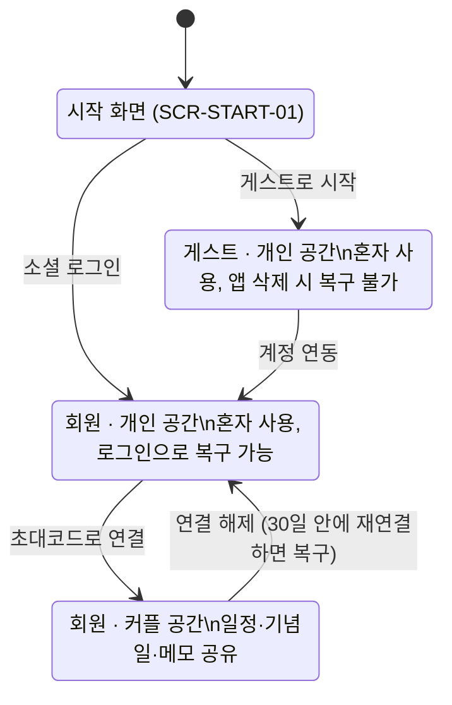

# 둘이서 PRD (MVP v0.1.0)

> 문서 버전: 0.9 (2026-10-31)
> 원본: 이 파일(`docs/PRD.md`)이 단일 기준이다. 다른 곳에 있는 사본은 기준이 아니다.
> 함께 보는 문서: `ERD.md`, `ERD.png`, `API.md`, `SCREENS.md`

---

## 0. 이 문서를 읽는 법

이 PRD는 둘이서 MVP(v0.1.0)의 단일 기준 문서다. 사람과 AI 에이전트가 같은 뜻으로 읽도록, 모든 항목에 ID를 붙이고 수용 기준을 검증 가능한 형태로 쓴다.

| 접두어 | 의미 | 예 |
| --- | --- | --- |
| D- | 결정 기록 | D-07 |
| SCR- | 화면 | SCR-CAL-01 |
| FR- | 기능 요구사항 | FR-MEMO-05 |
| FR-…ACn | 수용 기준 | FR-MEMO-05.AC2 |
| NFR- | 비기능 요구사항 | NFR-SEC-01 |
| Q- | 확인 필요 사항 | Q-01 |

**해석 규칙 (에이전트 필수)**

1. 이 문서에 없는 기능은 만들지 않는다. "범위 밖"에 있는 기능은 PRD가 수정되기 전까지 구현하지 않는다.
2. 내용이 충돌하면 우선순위는 결정 기록(D) > 권한 매트릭스 > 기능 요구사항(FR) > 화면 목록(SCR) 순이다.
3. "기본값"으로 표시된 결정은 확정과 똑같이 구현한다. 나중에 바뀔 수 있다는 표시일 뿐이다.
4. 확인 필요 사항(Q)에 기본값이 있으면 기본값으로 구현하고, 기본값이 없으면 추측하지 말고 작업을 멈춘 뒤 보고한다.
5. 수용 기준은 Given / When / Then 형식이며 그대로 테스트 케이스가 된다. 커밋, PR, 테스트 이름에 FR ID를 쓴다 (예: `FR-MEMO-05.AC2`).
6. 용어는 용어집의 뜻으로만 쓴다.

---

## 1. 제품 개요

**둘이서는 혼자서도, 커플이 함께도 쓰는 일정·메모 앱이다.** 혼자 쓰다가 상대를 초대하면 같은 캘린더와 메모장을 공유한다.

- **대상 사용자**: 연인과 일정·메모를 공유하려는 사람, 그리고 아직 상대 없이 혼자 기록하려는 사람
- **플랫폼**: Android (MVP). iOS는 다음 버전 (D-25)
- **서버**: Kotlin + Spring Boot + PostgreSQL

**핵심 가치**

1. 가입 없이 바로 시작: 게스트로 시작하고, 필요할 때 Google·Kakao로 연동한다.
2. 함께 보는 일정: 둘의 일정과 기념일이 한 캘린더에 모이고, 캘린더가 첫 화면이다.
3. 공지가 되는 메모: 따로 공지 게시판 없이, 메모를 고정하면 그게 공지가 된다.

**MVP 완료 기준**: 두 사람이 각자의 Android 기기에서 커플로 연결하고, 일정·기념일·메모를 만들면 상대 화면에 반영된다. 이 문서의 모든 FR 수용 기준이 테스트를 통과한다. 정량 목표(사용자 수 등)는 미정이다 (Q-02).

---

## 2. 용어집

아래 용어는 이 문서와 코드, UI 문구에서 이 뜻으로만 쓴다. 영문명은 코드 식별자 기준이다.

| 용어 | 영문명 | 정의 |
| --- | --- | --- |
| 사용자 | User | 앱을 쓰는 한 사람. 게스트 또는 회원이다 |
| 게스트 | Guest | 소셜 로그인 없이 시작한 사용자. 서버에 UUID로 식별되는 계정이 있지만, 앱 삭제나 기기 변경 시 복구할 수 없다 |
| 회원 | Member | Google 또는 Kakao 계정으로 로그인했거나 연동한 사용자. 같은 소셜 계정으로 다시 로그인하면 데이터가 복구된다 |
| 계정 연동 | Account linking | 게스트가 소셜 계정을 연결해 회원이 되는 것. 계정은 그대로이고 데이터도 유지된다 |
| 공간 | Space | 일정, 기념일, 메모가 속하는 단위. 사용자는 항상 공간 하나에 속한다 |
| 개인 공간 | Personal space | 커플 연결 전 사용자 혼자 쓰는 공간 |
| 커플 공간 | Couple space | 연결된 두 사용자가 함께 쓰는 공간. 연결되면 각자의 개인 공간 대신 이 공간을 쓴다 |
| 커플 연결 | Couple link | 두 회원이 초대코드로 커플 공간을 만드는 것. 한 사용자는 동시에 한 커플에만 속한다 |
| 초대코드 | Invite code | 커플 연결용 1회용 6자리 코드. 만든 지 10분 뒤 만료된다 |
| 연결 해제 | Unlink | 커플 연결을 끊는 것. 커플 공간은 유예 기간 동안 보관된다 |
| 유예 기간 | Grace period | 연결 해제 후 커플 공간을 보관하는 30일. 이 안에 같은 두 사람이 재연결하면 복구된다 |
| 작성자 | Author | 일정, 기념일, 메모를 처음 만든 사용자 |
| 상대 | Partner | 같은 커플 공간에 속한 다른 한 사용자 |
| 일정 | Event | 캘린더에 표시되는 항목. 반복하지 않는다 |
| 일정 메모 | Event note | 일정 안의 자유 텍스트 칸. 메모장의 메모와 다르다 |
| 일정 알림 | Event reminder | 사용자가 일정에 각자 설정하는 푸시 알림. 상대에게 공유되지 않는다 |
| 처음 만난 날 | Start date | 커플이 함께 정하는 기준일. 실제로 처음 만난 날이든 사귀기 시작한 날이든 두 사람이 고른다. D-day와 자동 기념일은 이 날을 1일로 계산한다 (D-61) |
| D-day | D-day | 처음 만난 날부터 오늘까지의 일수 (D+N) |
| 기념일 | Anniversary | 자동 기념일과 직접 기념일을 합친 말 |
| 자동 기념일 | Auto anniversary | 처음 만난 날로 자동 계산되는 기념일 (100일 단위, 매년) |
| 직접 기념일 | Custom anniversary | 사용자가 직접 등록한 기념일 (생일 등). 매년 반복할 수 있다 |
| 메모 | Memo | 메모장 탭의 항목. 제목, 본문, 메모 날짜(선택)로 이뤄진다 |
| 메모 날짜 | Memo date | 메모에 선택해서 붙이는 날짜. 붙이면 캘린더의 그 날에도 보인다 (D-38) |
| 알림 목록 | Notification inbox | 받은 알림을 모아 보는 화면. 각자의 것이며 30일 보관한다 (D-39) |
| 고정 핀 | Pin | 메모를 목록 맨 위 공지 영역에 고정하는 것. 커플 공간에서는 상대에게도 보인다 |
| 즐겨찾기 | Favorite | 사용자가 각자 메모에 표시하는 것. 상대에게 보이지 않는다 |
| 사람 색 | Person color | 일정이 누구의 것인지 나타내는 색. 나·상대·함께 세 가지이며 커플이 '우리 색상'에서 고른다 |
| 일정 대상 | Event target | 일정이 누구의 것인지: 특정 사용자 한 명 또는 '함께'. 화면에는 보는 사람 기준으로 나·상대·함께로 표시한다. 작성할 때는 나 또는 함께만 고를 수 있다 (D-34). 개인 공간에서는 항상 나 |
| 우리 색상 | Our colors | 커플 공간의 사람 색 설정. 두 사람이 함께 쓰는 값이다 |
| 프로필 | Profile | 사용자의 이름(닉네임)과 사진. 상대에게 보인다 |

---

## 3. 범위

MVP는 계정, 커플 연결, 캘린더, 기념일, 메모, 알림 여섯 영역이다. 아래 "범위 밖"은 요청이 있어도 PRD 수정 없이 만들지 않는다.

**MVP 포함**

| 영역 | 기능 | FR |
| --- | --- | --- |
| 계정 | 게스트 시작, Google·Kakao 로그인, 게스트→회원 연동, 로그아웃, 탈퇴, 프로필(이름·사진) | FR-AUTH |
| 커플 | 초대코드 생성·입력, 연결, 기록 가져오기, 연결 해제, 유예 기간 내 복구 | FR-COUPLE |
| 캘린더 | 월간 보기(첫 화면), 일정 작성·수정·삭제, 일정 대상(나·함께), 사람 색(우리 색상), 일정 메모, 일정 알림, 날짜 있는 메모 표시 | FR-CAL |
| 기념일 | D-day, 자동 기념일, 직접 기념일, 기념일 알림 | FR-ANNIV |
| 메모 | 작성·수정·삭제, 메모 날짜(선택), 고정 핀, 즐겨찾기, 정렬·보기 | FR-MEMO |
| 알림·설정 | 푸시 알림, 알림 목록(30일), 알림 종류별 켜고 끄기, 설정 화면, 정보(문의하기, 약관, 오픈소스 라이선스, 앱 버전·업데이트) | FR-NOTI, FR-SET |

**범위 밖 (MVP에서 만들지 않음)**

- iOS 앱, 웹 버전
- Naver 등 Google·Kakao 외 로그인
- 반복 일정 (기념일의 매년 반복만 예외)
- 일정 장소, 지도 연동, 외부 캘린더(Google 캘린더 등) 연동
- 메모 이미지 첨부, 태그, 검색, 체크리스트 (체크리스트는 v0.4에서 범위 밖으로 옮김)
- 메모 읽음 표시, 새 글(NEW) 표시
- 우리 색상에서 12색 밖의 색을 직접 고르기
- 상대가 만든 메모·일정 내용 수정 ('함께' 일정은 예외, D-12)
- 실시간 연결(WebSocket), 오프라인 작성·수정
- 채팅, 위젯, 데이터 내보내기
- 한 사용자가 여러 커플에 속하거나, 셋 이상이 한 공간을 쓰는 것
- 한 계정으로 여러 기기에 동시에 로그인하는 것 (D-51)

---

## 4. 사용자 상태 모델

사용자는 항상 아래 상태 중 하나다. 데이터는 공간에 속하므로(D-29), 상태가 바뀌면 보이는 공간이 바뀐다. 게스트는 연동해야 회원이 되고, 회원만 커플이 된다.

1. 시작 → 게스트·개인 공간: "게스트로 시작" (FR-AUTH-01)
2. 시작 → 회원: 소셜 로그인. 신규면 회원·개인 공간, 기존 회원이면 그 계정의 현재 상태로 들어간다 (FR-AUTH-02)
3. 게스트·개인 공간 → 회원·개인 공간: 계정 연동 (FR-AUTH-03). 연동하려는 계정이 이미 회원이면 게스트를 지우고 그 계정으로 로그인할 수 있다 (D-67)
4. 회원·개인 공간 → 회원·커플 공간: 초대코드로 연결 (FR-COUPLE-02)
5. 회원·커플 공간 → 회원·개인 공간: 연결 해제, 커플 공간은 30일 보관 (FR-COUPLE-05, FR-COUPLE-06)
6. 모든 상태 → 시작 화면: 회원의 로그아웃과 탈퇴, Kakao 계정 설정에서 둘이서 연결 끊기(D-87), 다른 기기에서 같은 계정으로 로그인(D-51), 게스트의 앱 삭제·기기 변경 (게스트는 복구 불가)

---

## 5. 화면 목록

하단 탭은 캘린더와 메모 두 개이고, 앱의 첫 화면은 캘린더다 (D-30). 설정, 기념일, 커플 연결은 탭이 아니라 캘린더 앱바에서 들어간다.

| 화면 ID | 화면 | 진입 | 비고 |
| --- | --- | --- | --- |
| SCR-START-01 | 시작 | 첫 실행, 로그아웃·탈퇴 후, 다른 기기 로그인으로 로그아웃됐을 때 | Google, Kakao, 게스트로 시작, 만 14세 이상 동의 문구 (FR-AUTH-08) |
| SCR-CAL-01 | 캘린더 홈 | 앱 진입 기본 화면, 하단 탭 | 월간 달력 + 선택한 날의 기념일·일정·메모 목록, 앱바(커플: D-day, 혼자: "기념일" 링크), 알림 버튼 |
| SCR-CAL-02 | 일정 상세 | 일정 선택 | 작성자에게만 수정·삭제 노출, 내 일정 알림 설정 |
| SCR-CAL-03 | 일정 작성·수정 | 캘린더의 추가 버튼, 상세의 수정 | |
| SCR-ANNIV-01 | 기념일 목록 | 캘린더 앱바의 D-day(커플) 또는 "기념일" 링크(혼자), 날짜 목록의 기념일, 기념일 푸시 | 자동 + 직접 기념일, 다가오는 순(2050년까지), 아래에 접힌 "지난 기념일" (D-71, D-75) |
| SCR-ANNIV-02 | 직접 기념일 작성·수정 | 기념일 목록의 추가 버튼 | |
| SCR-MEMO-01 | 메모 목록 | 하단 탭 | 상단 고정 영역(최대 3개 + 더보기), 정렬·보기 선택 |
| SCR-MEMO-02 | 고정 메모 전체 | 메모 목록의 "더보기" | 고정 메모가 4개 이상일 때만 진입점 노출 |
| SCR-MEMO-03 | 메모 상세 | 메모 선택 | 날짜(있으면), 고정, 즐겨찾기 |
| SCR-MEMO-04 | 메모 작성·수정 | 메모 목록의 추가 버튼, 상세의 수정 | |
| SCR-COUPLE-01 | 커플 연결 | 회원 첫 로그인 직후, 설정, 게스트가 연결하려고 연동을 마친 뒤 | "초대코드 만들기" / "초대코드 입력하기" 두 버튼 + "혼자 시작하기", 회원은 "다른 계정으로 로그인" (D-80). 앞 화면이 없는 진입에서는 뒤로 버튼이 없음 (D-96) |
| SCR-COUPLE-02 | 초대코드 만들기 | SCR-COUPLE-01, SCR-SET-01 연결 정보(혼자 사용 중) (D-97) | 6자리 코드, 남은 시간(10분), 공유, 재요청(1분 간격), 만료 시 자동 재발급, 연결되면 자동으로 캘린더로 |
| SCR-COUPLE-03 | 초대코드 입력하기 | SCR-COUPLE-01, SCR-SET-01 연결 정보(혼자 사용 중) (D-97) | 6자리를 넣으면 바로 연결 버튼이 켜짐. 상대 미리보기 없음 (D-72). 오류는 종류마다 다른 문구 (D-95) |
| SCR-COUPLE-04 | 연결 완료 시트 | 연결 직후 캘린더 위에 뜸 (양쪽 모두) | 처음 만난 날 입력(건너뛰기 가능), 기존 기록 가져오기 선택과 종류별 개수 (D-49, D-93) |
| SCR-SET-01 | 전체 메뉴 (설정) | 캘린더 상단 햄버거 메뉴 | 프로필(이름·사진), 우리 색상, 계정(연동, 탈퇴), 커플 관리, 알림 설정, 정보, 로그아웃 |
| SCR-SET-02 | 알림 설정 | SCR-SET-01 | 알림 종류별 켜고 끄기 |
| SCR-SET-03 | 우리 색상 | SCR-SET-01 | 나·상대·함께 색을 12색 중 선택, 캘린더 미리보기, 같은 색 경고 |
| SCR-SET-04 | 프로필 수정 | SCR-SET-01 | 이름, 사진 변경 (사진 선택 시트: 앨범, 카메라, 삭제) |
| SCR-NOTI-01 | 알림 목록 | SCR-CAL-01 앱바의 알림 버튼 | 최근 30일 알림, 안 읽음 표시, 누르면 관련 화면으로 |

---

## 6. 기능 요구사항

각 FR은 설명 한 줄과 수용 기준(AC)으로 이뤄진다. 권한은 7장 권한 매트릭스를 따른다.

### 6.1 계정 (FR-AUTH)

**FR-AUTH-01 게스트로 시작** (D-01, D-02)

- AC1: Given 앱을 처음 실행한 사용자, When "게스트로 시작"을 누르면, Then 서버에 UUID로 식별되는 게스트 계정과 개인 공간이 만들어지고 SCR-CAL-01로 이동한다.
- AC2: Given 게스트로 시작한 적이 있는 기기, When 앱을 다시 실행하면, Then 저장된 인증 정보로 같은 게스트 계정에 자동으로 들어간다.
- AC3: Given 게스트가 앱을 삭제했거나 기기를 바꾼 상황, When 앱을 새로 설치해 실행하면, Then 이전 게스트 계정에 접근할 방법은 없고 SCR-START-01이 표시된다.

**FR-AUTH-02 소셜 로그인** (D-01, D-03)

- AC1: Given 가입한 적 없는 Google 또는 Kakao 계정, When 로그인하면, Then 회원 계정과 개인 공간이 만들어지고 SCR-COUPLE-01이 표시된다.
- AC2: Given 이미 회원인 소셜 계정, When 다른 기기나 재설치한 앱에서 로그인하면, Then 그 계정이 속한 공간의 데이터가 그대로 보인다.
- AC3: Given 한 기기에서 로그인 중인 회원, When 다른 기기에서 같은 계정으로 로그인하면, Then 이전 기기의 로그인과 푸시는 끊긴다. 이전 기기는 다음에 서버에 요청할 때 "다른 기기에서 로그인해서 로그아웃됐어요"를 보여주고 SCR-START-01로 이동한다 (D-51).

**FR-AUTH-03 게스트 → 회원 연동** (D-03)

- AC1: Given 게스트, When 설정에서 Google 또는 Kakao 연동을 완료하면, Then 같은 계정이 회원으로 바뀌고 기존 일정·기념일·메모가 모두 유지된다. 닉네임이 아직 "게스트"이면 소셜 프로필 이름으로 바뀐다(FR-AUTH-07 AC1과 같은 규칙). 사용자가 직접 바꾼 닉네임은 그대로 둔다 (D-68).
- AC2: Given 연동하려는 소셜 계정이 이미 다른 회원 계정에 쓰이고 있음, When 연동을 시도하면, Then 연동하지 않고 "이미 가입된 계정이에요" 안내와 [그 계정으로 로그인] 버튼을 보여준다. 두 계정의 데이터는 합치지 않는다 (Q-01).
- AC3: Given AC2의 안내, When [그 계정으로 로그인]을 누르면, Then "게스트로 쓴 기록은 모두 삭제돼요"를 한 번 더 확인받고, 확인하면 게스트 계정과 기록을 탈퇴처럼 바로 삭제한 뒤 그 소셜 계정으로 로그인해 그 계정의 현재 상태로 들어간다 (D-67). 취소하면 게스트로 계속 쓴다.
- AC4: Given 게스트가 커플 연결 메뉴의 [로그인하고 연결하기]로 연동을 시작함, When 연동을 마치면, Then SCR-COUPLE-01(회원 화면)로 돌아간다 (D-79).

**FR-AUTH-04 게스트 데이터 안내** (D-09)

- AC1: Given 게스트, When SCR-SET-01을 열면, Then 상단에 "앱을 삭제하거나 기기를 바꾸면 데이터를 복구할 수 없어요" 안내와 계정 연동 버튼이 항상 보인다.
- AC2: Given 게스트, When 커플 연결 메뉴(전체 메뉴의 [상대와 연결하기]와 연결 정보 행 포함)를 누르면, Then 연결 화면 대신 계정 연동이 필요하다는 안내와 연동 버튼이 표시된다 (D-07).

**FR-AUTH-05 로그아웃**

- AC1: Given 회원, When 로그아웃을 확인하면, Then 기기의 인증 정보와 캐시가 지워지고 SCR-START-01로 이동한다. 서버는 그 기기의 푸시 토큰을 지워 더 이상 푸시를 보내지 않는다 (D-50). 서버 데이터는 그대로다.
- AC2: Given 게스트, When 설정을 열면, Then 로그아웃 메뉴는 보이지 않는다 (로그아웃하면 다시 들어올 방법이 없으므로).
- AC3: Given 회원, When SCR-COUPLE-01의 "다른 계정으로 로그인"을 누르면, Then AC1과 같은 로그아웃 확인을 거쳐 로그아웃하고 SCR-START-01로 이동한다 (D-80).
- AC4: Given 오프라인이거나 서버 오류가 난 상황, When 로그아웃을 확인하면, Then 로그아웃하지 않고 오프라인이면 "인터넷 연결이 필요해요", 서버 오류면 공통 오류 안내를 보여준 뒤 로그인 상태 그대로 둔다 (D-86, D-88).

**FR-AUTH-06 탈퇴** (Google Play 정책상 필수)

- AC1: Given 개인 공간의 사용자(게스트 포함), When 탈퇴를 최종 확인하면, Then 계정과 개인 공간의 모든 데이터가 즉시 삭제되고 SCR-START-01로 이동한다.
- AC2: Given 커플 공간의 사용자, When 탈퇴를 최종 확인하면, Then 먼저 연결 해제(FR-COUPLE-05)가 처리된 뒤 계정이 삭제된다. 상대에게는 탈퇴 전용 해제 알림이 간다 (8장, D-53). 커플 공간은 장애 복구를 위해 서버에 90일간 보관한 뒤 영구 삭제한다. 보관 중인 데이터는 어떤 사용자에게도 보이지 않고 운영자만 복구할 수 있다 (D-36).
- AC3: Given Kakao로 로그인하는 회원, When 탈퇴하면, Then 서버는 Kakao 계정과 둘이서의 앱 연결도 끊는다 (기본값).
- AC4: Given Kakao로 로그인하는 회원, When 사용자가 Kakao 계정 설정에서 둘이서와의 연결을 끊어 Kakao가 서버에 알리면, Then 서버는 AC1·AC2와 같이 탈퇴 처리한다(커플이면 상대에게 탈퇴 전용 해제 알림). 그 회원이 Google 로그인도 함께 쓰고 있으면 탈퇴하지 않고 Kakao 로그인 수단만 지운다. 탈퇴 처리된 기기는 다음에 서버에 요청할 때 SCR-START-01로 이동한다 (D-87).
- AC5: Given 오프라인이거나 서버 오류가 난 상황, When 탈퇴를 최종 확인하면, Then 탈퇴하지 않고 FR-AUTH-05 AC4와 같이 안내한 뒤 그대로 둔다 (D-86, D-88).

**FR-AUTH-07 프로필 (이름·사진)**

- AC1: Given 소셜 로그인으로 가입한 회원, When 가입이 완료되면, Then 소셜 프로필 이름이 닉네임 기본값이 된다. 10자가 넘으면 앞 10자만 쓴다 (D-56). 소셜 계정에서 이름을 받지 못하면 "사용자"를 쓴다 (D-69). 게스트의 기본 닉네임은 "게스트"다.
- AC2: Given 사용자, When 설정에서 닉네임을 바꾸면, Then 상대 화면의 작성자 표시에도 바뀐 닉네임이 보인다.
- AC3: Given 사용자, When SCR-SET-04에서 앨범이나 카메라로 사진을 골라 저장하면, Then 프로필 사진이 바뀌고 상대 화면의 아바타에도 보인다 (D-33).
- AC4: Given 프로필 사진이 없는 사용자, Then 아바타는 사람 색 배경에 '나' 또는 '너' 글자로 표시된다.
- AC5: Given 사진을 삭제함, Then 서버의 사진 파일도 삭제되고 AC4의 표시로 돌아간다 (NFR-FILE-01).

**FR-AUTH-08 이용 동의** (D-63)

- AC1: Given SCR-START-01, Then 시작 버튼 아래에 "시작하면 만 14세 이상이며, 이용약관과 개인정보처리방침에 동의하는 것으로 봐요." 문구와 두 문서 링크가 보인다. 나이는 따로 묻지 않는다.
- AC2: 링크는 웹 페이지를 연다. 페이지 주소와 내용은 Q-03에서 정한다.

**FR-AUTH-09 앱 밖 계정 삭제 요청** (Google Play 정책, D-66)

- AC1: 앱 밖에서 볼 수 있는 계정 삭제 안내 웹 페이지가 있고, Google Play Console에 등록한다. 약관·개인정보처리방침과 같은 곳에 둔다.
- AC2: 페이지는 앱에서 탈퇴하는 방법(전체 메뉴 › 계정 › 탈퇴하기)과, 앱을 쓸 수 없을 때 문의 메일(Q-10)로 삭제를 요청하는 방법, 삭제되는 데이터와 보관 기간(D-36)을 안내한다.
- AC3: 메일 요청은 운영자가 로그인 수단으로 본인을 확인한 뒤 FR-AUTH-06과 같은 방식으로 처리한다. 게스트는 본인 확인 수단이 없어 앱에서만 탈퇴할 수 있다고 안내한다.

### 6.2 커플 연결 (FR-COUPLE)

**FR-COUPLE-01 초대코드 만들기** (D-05)

- AC1: Given 개인 공간의 회원, When SCR-COUPLE-02에 들어가면, Then 6자리 초대코드(영문과 숫자, 헷갈리는 0·O·1·I·L 제외, 대문자로 표시)와 남은 유효 시간(10분)이 표시되고 공유 버튼으로 코드를 보낼 수 있다. 공유와 복사에는 코드 6자리만 담고, 복사하면 버튼 이름이 "복사됨"으로 바뀐다 (D-102).
- AC2: Given 만든 지 10분이 지난 코드, When 상대가 입력하면, Then "만료된 코드"로 거부된다.
- AC3: Given 초대코드를 만든 회원, When 재요청하면, Then 기존 코드는 즉시 만료되고 새 코드가 표시된다. 재요청은 마지막 발급 후 1분이 지나야 할 수 있고, 그 전에는 재요청 버튼에 남은 시간이 표시된다.
- AC4: Given 코드를 입력하는 회원, When 소문자로 입력하면, Then 대소문자를 구분하지 않고 같은 코드로 처리한다.
- AC5: Given SCR-COUPLE-02를 보고 있는 회원, When 코드의 남은 시간이 0이 되면, Then 앱이 새 코드를 자동으로 발급받아 보여주고(남은 시간 다시 10분) 새 코드가 만들어졌다는 안내를 표시한다. 화면을 나갔다가 다시 들어왔을 때 코드가 만료돼 있어도 같은 방식으로 새 코드를 보여준다. 앱이 백그라운드에 있는 동안에는 발급하지 않는다 (D-42).
- AC6: Given SCR-COUPLE-02에 들어온 회원, When 코드를 아직 받지 못했으면, Then 코드 칸은 빈 칸으로 보이고 문구는 따로 없다. 오프라인이라 코드를 받지 못하면 "인터넷 연결이 필요해요"를 보여준다 (D-95).

**FR-COUPLE-02 초대코드 입력하기**

- AC1: Given 개인 공간의 회원 B와 유효한 코드를 가진 회원 A, When B가 A의 코드를 입력하면, Then 커플 공간이 만들어지고 코드는 사용 처리되며, 두 사람 모두 SCR-CAL-01로 이동한 뒤 그 위에 연결 완료 시트(SCR-COUPLE-04)가 뜬다 (D-48, D-49).
- AC2: Given 존재하지 않는 코드, 만료된 코드, 이미 사용된 코드, 자신이 만든 코드, When 입력하면, Then 각각 구분된 오류 문구(아래 표)로 거부된다. 재요청이나 자동 재발급으로 바뀐 이전 코드는 "만료된 코드"로 안내한다 ("만료된 코드예요. 상대에게 새 코드를 받아 주세요.", D-47).
- AC3: Given 코드를 만든 A가 그 사이 다른 사람과 연결됨, When B가 A의 코드를 입력하면, Then "사용할 수 없는 코드"(아래 표)로 거부된다.
- AC4: Given 최근 1시간 안에 잘못된 코드를 10번 입력한 사용자, When 코드를 다시 입력하면, Then 거부되고 입력 제한 안내(아래 표)를 보여준다. 그 10번 중 가장 오래된 실패가 1시간을 지나면 다시 입력할 수 있다 (NFR-SEC-03, D-83).
- AC5: Given 코드를 만들고 기다리는 A, When B가 연결하면, Then A의 앱은 서버의 동기화 신호(FCM)로 연결을 알아채고, 앱을 보고 있으면 바로 SCR-CAL-01로 이동한다. 신호가 늦거나 오지 않을 때를 대비해 SCR-COUPLE-02는 열려 있는 동안 5초마다 연결 여부를 확인하고, [연결 확인하기]로 바로 확인할 수도 있다. 앱이 꺼져 있었으면 다음 실행 때 SCR-CAL-01과 시트가 뜬다 (D-48). 오프라인이면 5초마다 하는 확인은 안내 없이 건너뛰고, [연결 확인하기]는 "인터넷 연결이 필요해요"를 보여준다 (D-95).

**초대코드 오류 문구** (D-95). 코드 오류는 SCR-COUPLE-03의 코드 칸 아래에 한 줄로 보여준다. 표에 없는 오류는 공통 오류(D-88), 오프라인은 "인터넷 연결이 필요해요"(NFR-OFF-02)다.

| 경우 | 문구 |
| --- | --- |
| 존재하지 않는 코드 (형식이 틀린 코드 포함) | "없는 코드예요. 코드를 다시 확인해 주세요." |
| 만료된 코드 (재요청·자동 재발급으로 바뀐 이전 코드 포함, D-47) | "만료된 코드예요. 상대에게 새 코드를 받아 주세요." |
| 이미 사용된 코드 | "이미 사용된 코드예요. 상대에게 새 코드를 받아 주세요." |
| 자신이 만든 코드 | "내가 만든 코드예요. 상대에게 받은 코드를 입력해 주세요." |
| 사용할 수 없는 코드 (AC3) | "사용할 수 없는 코드예요. 상대에게 새 코드를 받아 주세요." |
| 입력 제한 (AC4) | "코드를 너무 많이 틀렸어요. [N]분 뒤에 다시 입력해 주세요." [N]은 다시 입력할 수 있을 때까지 남은 시간을 분 단위로 올림한 값이다 (최소 1) |

**FR-COUPLE-03 연결 시 기존 기록 가져오기** (D-08)

- AC1: Given 연결 직후 개인 공간에 일정·기념일·메모가 있는 사용자, When SCR-COUPLE-04에서 "가져오기"를 고르면, Then 그 데이터가 작성자 정보를 유지한 채 커플 공간으로 옮겨진다. 시트는 혼자 쓴 기록의 종류별 개수를 "일정 [N]개, 기념일 [N]개, 메모 [N]개가 있어요."로 보여준다. 기념일은 직접 기념일만 센다 (D-93, Q-13).
- AC2: Given 같은 상황, When "가져오지 않기"를 고르면, Then 개인 공간의 데이터는 삭제된다. 삭제 전 이 결과를 "혼자 쓴 기록을 삭제할까요?" 다이얼로그로 한 번 더 확인받는다. 본문은 "가져오지 않으면 혼자 쓴 일정 [N]개, 기념일 [N]개, 메모 [N]개가 삭제되고 되돌릴 수 없어요."다 (D-93).
- AC3: 두 사람은 각자 자신의 데이터에 대해서만 고른다.
- AC4: Given 혼자 쓴 기록이 있는 사용자, Then 가져올지 정해 [시작하기]를 누르기 전에는 시트를 닫을 수 없다. 정하지 않고 앱을 끄면 다음 실행 때 시트가 다시 뜬다.
- AC5: 시트를 처음 열면 [가져오기]가 미리 선택돼 있다 (D-76).
- AC6: Given 혼자 쓴 기록이 없는 사용자, When 시트를 닫거나 [시작하기]를 누르기 전에 앱을 끄면, Then 다음 실행 때 시트가 다시 뜬다. 시트를 닫거나 [시작하기]를 누른 뒤에는 그 연결에 대해 다시 뜨지 않는다 (D-98).

**FR-COUPLE-04 처음 만난 날 입력**

- AC1: Given 연결된 커플, When 둘 중 누구든 연결 완료 시트(SCR-COUPLE-04) 또는 설정에서 처음 만난 날을 입력하거나 수정하면, Then D-day와 자동 기념일이 다시 계산되어 두 사람 모두에게 반영된다 (Q-07). 한번 정한 처음 만난 날은 다른 날로 바꿀 수만 있고 지울 수는 없다 (D-84).
- AC2: Given 처음 만난 날이 없는 커플, When SCR-CAL-01을 열면, Then D-day 자리에 처음 만난 날 입력 안내가 보인다.
- AC3: 연결 완료 시트에서 처음 만난 날은 건너뛸 수 있다. 오늘보다 뒤의 날짜와 1950년 1월 1일보다 앞의 날짜는 고를 수 없다 (D-74).
- AC4: Given SCR-COUPLE-04, When 처음 만난 날 칸을 누르면, Then 처음 만난 날 선택 시트가 위에 뜨고, 그 시트의 [저장]은 칸에 날짜를 채우기만 한다. 서버에는 [시작하기]를 누를 때 저장한다. [나중에 하기]는 고른 날짜를 비운다. 처음 만난 날이 이미 있는 공간(상대가 먼저 정했거나 복구된 공간)이면 칸에 그 날짜가 보이고 [나중에 하기]는 없다 (D-98, D-84).
- AC5: Given 처음 만난 날이 없는 커플, When SCR-SET-01을 열면, Then 프로필 카드에는 D+N과 "[처음 만난 날]부터 함께하고 있어요" 줄이 없고 [처음 만난 날 수정]은 그대로 보인다. 연결 정보의 처음 만난 날·함께한 지 값도 보이지 않는다 (D-99).

**FR-COUPLE-05 연결 해제** (D-06)

- AC1: Given 커플 공간의 사용자, When 설정에서 연결 해제를 최종 확인하면, Then 두 사람 모두 커플 공간에서 나가고 각자 빈 개인 공간에서 다시 시작하며, 상대에게 해제 알림이 간다 (D-37).
- AC2: Given 해제된 커플 공간, When 해제 후 30일이 지나면, Then 커플 공간과 그 안의 모든 데이터가 영구 삭제된다.
- AC3: Given 연결이 해제된 두 사람(해제한 사람과 상대 모두), When 앱이 해제를 알게 되면(해제 직후, 해제 푸시 수신, 또는 다음 실행 시), Then 앱은 로그인 정보를 뺀 기기의 데이터(캐시, 화면 상태 등)를 모두 지우고 재시작해 자동 로그인한 뒤 SCR-COUPLE-01(연결 방법 선택)로 이동한다. 서버의 프로필과 알림 설정은 유지된다 (D-37). 재시작은 앱을 끄지 않고 앱 상태를 처음부터 다시 만드는 것이다 (D-103).
- AC4: Given 연결 직후 아직 기록 가져오기를 정하지 않은 사용자, When 연결이 해제되면, Then 그 사용자의 혼자 쓴 기록은 빈 개인 공간 대신 원래 개인 공간으로 그대로 돌아간다 (D-78).
- AC5: Given 상대가 먼저 연결을 해제한 것을 아직 모르는 사용자, When 처음 만난 날이나 우리 색상을 저장하다 서버가 커플 공간이 아니라고 답하면, Then 앱은 해제를 안 것으로 보고 AC3과 같이 초기화한다 (D-103).

**FR-COUPLE-06 유예 기간 내 복구** (D-06)

- AC1: Given 해제 후 30일이 지나지 않은 두 사람, When 둘이 다시 초대코드로 연결하면, Then 새 커플 공간 대신 이전 커플 공간이 복구된다.
- AC2: Given 해제 후 각자 개인 공간에 새로 만든 데이터, When 복구되면, Then FR-COUPLE-03과 같은 방식으로 가져올지 고른다.

### 6.3 캘린더 (FR-CAL)

**FR-CAL-01 캘린더 홈** (D-30)

- AC1: Given 로그인된 사용자, When 앱을 열면, Then SCR-CAL-01이 오늘이 속한 달로 표시되고 오늘 날짜가 선택되어 있다.
- AC2: Given 일정, 기념일, 날짜가 있는 메모(D-38) 중 하나라도 있는 날, When 월간 달력을 보면, Then 그 날에 표시가 있고, 날짜를 누르면 아래 목록에 그 날의 항목이 보인다. 순서는 기념일, 종일 일정, 시간 일정(시작 시간순), 메모 순이다. 기념일은 "기념일" 표시와 함께 맨 위에 나오고 누르면 SCR-ANNIV-01로 간다. 달력의 날짜 표시에서 기념일은 사람 색 점과 모양이 다른 브랜드 색 표시로 구분한다 (D-65).
- AC3: Given 커플이고 처음 만난 날이 있음, When SCR-CAL-01을 열면, Then 상단에 D+N이 보인다 (FR-ANNIV-01).
- AC4: Given 안 읽은 알림이 있는 사용자, When SCR-CAL-01을 열면, Then 앱바의 알림 버튼에 점이 보이고, 누르면 SCR-NOTI-01로 이동한다 (FR-NOTI-05).
- AC5: Given 개인 공간의 사용자, When SCR-CAL-01을 열면, Then 앱바에 내 아바타, "나의 캘린더", "기념일 ›" 링크가 보이고, 링크를 누르면 SCR-ANNIV-01로 이동한다 (D-54).
- AC6: 캘린더는 1950년 1월부터 2050년 12월까지 넘겨 볼 수 있다. 일정, 메모 날짜, 직접 기념일, 처음 만난 날의 날짜도 이 범위 안에서만 고를 수 있고, 서버도 범위 밖 날짜를 거부한다 (D-74).

**FR-CAL-02 일정 작성** (D-10)

- AC1: Given 사용자, When 제목, 시작 일시, 종료 일시를 입력하고 저장하면, Then 일정이 현재 공간에 만들어진다. 제목은 필수다. 제목은 앞뒤 공백을 지운 값으로 저장하고, 공백만 있는 제목은 제목이 없는 것으로 본다 (D-89). 작성 화면에는 시작 행과 종료 행이 따로 있고, 종료 날짜를 바꿔 여러 날 일정을 만든다 (D-64).
- AC2: Given 종일을 켠 일정, When 저장하면, Then 시간 없이 시작일과 종료일만 저장된다.
- AC3: Given 종료 일시가 시작 일시보다 이른 입력, When 저장하면, Then 저장되지 않고 오류가 표시된다.
- AC4: 일정 대상(나 또는 함께, 기본은 나. 상대는 고를 수 없음, D-34), 일정 메모, 일정 알림(기본은 없음, D-59)은 선택 항목이다. 개인 공간에서는 대상 선택이 보이지 않고 항상 나다. 일정의 색은 대상의 사람 색을 따른다 (FR-CAL-04).
- AC5: 여러 날에 걸친 일정은 시작일부터 종료일까지 모든 날짜에 표시된다.

**FR-CAL-03 일정 수정·삭제** (D-12)

- AC1: Given 내가 만든 일정, When SCR-CAL-02를 열면, Then 수정과 삭제를 할 수 있다.
- AC2: Given 상대가 만든 일정 중 대상이 '함께'가 아닌 것, When SCR-CAL-02를 열면, Then 수정·삭제 메뉴가 보이지 않는다. 서버도 작성자가 아닌 사용자의 수정·삭제 요청을 거부한다 (NFR-SEC-02).
- AC3: SCR-CAL-02에는 작성자 닉네임이 표시된다.
- AC4: Given 대상이 '함께'인 일정, Then 작성자와 상대 모두 수정·삭제할 수 있다 (D-12). 단 대상(나·함께)은 작성자만 바꿀 수 있고, 상대가 수정할 때는 대상 선택 대신 읽기 전용 "누구의 일정 · 함께"와 안내 "함께 일정의 대상은 만든 사람만 바꿀 수 있어요."가 보인다 (D-52, D-77).
- AC5: 대상이 '함께'가 아닌 일정은 작성자 본인의 일정이므로 작성자만 수정·삭제한다 (D-34).

**FR-CAL-04 사람 색 (우리 색상)** (D-15)

- AC1: Given 커플 공간, Then 색은 사람 색 세 가지(두 사용자 각각, 함께)로 정해지고 일정은 대상의 색으로 표시된다. 일정마다 색을 고르지 않는다.
- AC2: Given 커플의 누구든, When SCR-SET-03에서 12색 팔레트 중 각 사람 색과 함께 색을 바꾸고 [완료]를 누르면, Then 두 사람 화면에 모두 반영된다. 화면에는 보는 사람 기준으로 나·상대·함께로 표시된다. 색을 누르면 미리보기만 바뀌고 [완료]에서 바뀐 색만 한 번에 저장한다. 저장에 실패하거나 오프라인이면 화면을 그대로 두고 안내한다. 저장하지 않고 뒤로 가면 바꾼 색은 묻지 않고 버린다 (D-100).
- AC3: 기본값은 초대코드를 만든 사람 주황, 입력한 사람 파랑, 함께 보라다 (앱 아이콘 색).
- AC4: Given 두 대상이 같은 색, When 저장하면, Then 저장되지만 같은 색이라는 경고 배너가 보인다.
- AC5: Given 개인 공간, Then 사람 색은 나 하나뿐이고 기본은 주황이다.
- AC6: 사람 색은 색만으로 의미를 전달하지 않는다. 항상 라벨(나·상대·함께)이나 아바타 글자와 함께 표시한다.
- AC7: Given SCR-SET-03, When [기본 색으로 되돌리기]를 누르면, Then 보는 사람 기준으로 나 주황, 상대 파랑, 함께 보라로 돌아간다(개인 공간은 나 주황). 저장은 AC2처럼 [완료]에서 한다. 코드를 입력한 사람에게는 AC3의 처음 기본값과 나·상대 색이 반대일 수 있다 (D-101).

**FR-CAL-05 일정 알림** (D-16)

- AC1: Given 아무 일정(상대의 일정 포함), When 사용자가 알림을 "없음, 정시, 10분 전, 1시간 전, 1일 전" 중 하나로 고르면, Then 그 사용자에게만 해당 시각에 푸시가 온다.
- AC2: Given 사용자 A가 일정에 알림을 설정함, When 상대 B가 같은 일정을 보면, Then B에게는 A의 알림 설정이 보이지 않고 B의 설정만 보인다.
- AC3: Given 종일 일정, When 알림을 고르면, Then 선택지는 "없음, 당일 오전 9시, 1일 전 오전 9시"다.
- AC4: Given 알림이 설정된 일정, When 누구든('함께' 일정이면 상대도) 일시를 바꾸면, Then 모든 사용자의 알림 시각이 새 일시 기준으로 다시 계산된다. 이미 보낸 알림도 새 시각이 아직 오지 않았으면 다시 보낸다. 종일 일정을 시간 일정으로(또는 그 반대로) 바꾸면 그 일정의 모든 사용자 알림은 "없음"으로 돌아간다 (D-91).
- AC5: 알림 시각은 정시 = 시작 시각, 10분 전·1시간 전 = 그만큼 앞, 1일 전 = 시작 24시간 전이다. 종일 일정의 "당일 오전 9시"·"1일 전 오전 9시"는 알림을 설정한 사람의 시간대 기준이다. 계산한 시각이 이미 지났으면(끝난 일정 포함) 설정은 저장되지만 푸시는 보내지 않는다 (D-90).
- AC6: Given 종일 일정에 알림을 설정한 사용자, When 그 사용자의 시간대가 바뀌면, Then 아직 보내지 않은 종일 일정 알림만 새 시간대 기준으로 다시 계산된다. 시간 일정의 알림은 그대로다 (D-91).

### 6.4 기념일 (FR-ANNIV)

**FR-ANNIV-01 D-day** (D-14, D-23)

- AC1: Given 처음 만난 날이 2026-01-01인 커플, When 2026-01-01에 SCR-CAL-01을 열면, Then D+1이 표시된다 (처음 만난 날 = 1일).
- AC2: Given 개인 공간의 사용자, Then D-day는 표시되지 않는다.

**FR-ANNIV-02 자동 기념일** (D-20, D-23)

- AC1: Given 처음 만난 날이 있는 커플, Then 100일, 200일 … 1000일과 매년 N주년이 자동 기념일로 계산되어 캘린더와 SCR-ANNIV-01에 표시된다. 매년 N주년은 캘린더 끝(2050년 12월)까지 계산한다 (D-74).
- AC2: Given 처음 만난 날이 2026-01-01, Then 100일은 2026-04-10이고, 1주년은 2027-01-01이다.
- AC3: 자동 기념일은 수정·삭제할 수 없다. 처음 만난 날을 바꾸면 다시 계산된다.

**FR-ANNIV-03 직접 기념일** (D-20)

- AC1: Given 사용자(개인·커플 공간 모두), When 이름과 날짜를 입력하고 "매년 반복"을 켜거나 끄고 저장하면, Then 직접 기념일이 만들어지고 캘린더와 목록에 표시된다.
- AC2: 직접 기념일의 수정·삭제는 작성자만 할 수 있다 (D-12와 같은 규칙).
- AC3: Given 2월 29일에 매년 반복하는 기념일, When 윤년이 아닌 해이면, Then 2월 28일에 표시된다.

**FR-ANNIV-04 기념일 목록**

- AC1: Given 사용자, When SCR-ANNIV-01을 열면, Then 오늘(오늘 포함)부터 2050년 12월 31일까지의 기념일이 모두 가까운 순으로 보이고, 각 항목에 남은 일수(D-N, 오늘은 D-day)가 표시된다. 매년 반복하는 기념일은 해마다 한 줄씩 나온다 (D-75).
- AC2: Given 개인 공간의 사용자, Then SCR-ANNIV-01에는 함께한 날 카드 없이 직접 기념일 목록만 보인다 (D-54).
- AC3: Given 날짜가 지난 1회성(매년 반복 아님) 직접 기념일, Then 목록 아래 "지난 기념일" 영역에 최근 순으로 보인다. 이 영역은 처음에 접혀 있고, 항목을 누르면 작성자는 SCR-ANNIV-02에서 수정·삭제할 수 있다 (D-71).
- AC4: Given 처음 만난 날이 없는 커플, When SCR-ANNIV-01을 열면, Then 함께한 날 카드 자리에 처음 만난 날 입력 안내가 보이고 자동 기념일은 나오지 않는다 (FR-COUPLE-04 AC2와 같은 안내).

### 6.5 메모 (FR-MEMO)

**FR-MEMO-01 메모 목록**

- AC1: Given 사용자, When SCR-MEMO-01을 열면, Then 고정되지 않은 메모가 작성일 기준 최신순으로 보인다.
- AC2: Given 보기 선택, When "오래된순"을 고르면 작성일 오래된순, "즐겨찾기"를 고르면 내가 즐겨찾기한 메모만 최신순으로 보인다.
- AC3: 각 항목에는 제목(없으면 본문 첫 줄), 작성자 닉네임, 작성일, 메모 날짜(있으면)가 보인다.

**FR-MEMO-02 메모 작성** (D-19, D-38)

- AC1: Given 사용자, When 제목, 본문 중 하나 이상을 입력하고 저장하면, Then 메모가 현재 공간에 만들어진다.
- AC2: Given 둘 다 비어 있음, When 저장하면, Then 저장되지 않는다.
- AC3: Given 메모 작성 화면, Then 메모 날짜는 기본으로 비어 있고, "날짜 추가"를 눌러야 날짜를 고를 수 있다. 붙인 날짜는 빼거나 바꿀 수 있다.
- AC4: Given 날짜를 붙인 메모, When 저장하면, Then 메모 탭과 함께 캘린더의 그 날에도 표시된다 (FR-CAL-01).

**FR-MEMO-03 메모 수정·삭제** (D-17)

- AC1: Given 내가 만든 메모, Then 제목, 본문, 메모 날짜를 수정하고 메모를 삭제할 수 있다.
- AC2: Given 상대가 만든 메모, Then 수정·삭제 메뉴가 보이지 않는다. 서버도 거부한다 (NFR-SEC-02).

**FR-MEMO-04 체크리스트** — 삭제됨 (PRD v0.4). 체크리스트는 범위 밖으로 옮겼다 (D-19).

**FR-MEMO-05 고정 핀** (D-18, D-21)

- AC1: Given 같은 공간의 누구든, When 아무 메모나 고정하거나 해제하면, Then 두 사람의 목록에 모두 반영된다. 고정 개수에는 제한이 없다.
- AC2: Given 고정된 메모가 3개 이하, When SCR-MEMO-01을 열면, Then 목록 맨 위 고정 영역에 모두 보이고 "더보기"는 없다.
- AC3: Given 고정된 메모가 4개 이상, When SCR-MEMO-01을 열면, Then 고정 영역에 가장 최근에 고정한 3개만 보이고 "더보기"가 나타나며, 누르면 SCR-MEMO-02에서 전체가 최근 고정순으로 보인다.
- AC4: 고정된 메모는 아래 일반 목록에 중복으로 나오지 않는다.

**FR-MEMO-06 즐겨찾기** (D-24)

- AC1: Given 사용자 A, When 메모를 즐겨찾기하면, Then A의 "즐겨찾기" 보기에만 나타나고, 상대 B에게는 즐겨찾기 표시가 보이지 않는다.

### 6.6 알림 (FR-NOTI)

알림 종류와 기본값은 8장 알림 정책 표를 따른다.

**FR-NOTI-01 알림 권한**

- AC1: Given Android 13 이상, When 사용자가 처음 알림이 필요한 기능(일정 알림 설정, 커플 연결, 직접 기념일 저장)을 쓰면, Then 알림 권한을 요청한다 (D-70). 거부해도 앱의 다른 기능은 쓸 수 있다.

**FR-NOTI-02 알림 종류별 켜고 끄기**

- AC1: Given 사용자(게스트 포함), When SCR-SET-02에서 알림 종류를 끄면, Then 그 종류의 푸시는 더 이상 오지 않는다. 설정은 서버에 저장되어 재설치 후 같은 계정으로 들어오면 유지된다 (D-62).

**FR-NOTI-03 푸시를 눌렀을 때**

- AC1: Given 푸시 알림, When 누르면, Then 관련 화면(일정 상세, 메모 상세, 기념일 목록, 설정)으로 이동한다. 연결·해제 알림(상대 탈퇴로 인한 해제 포함)은 설정(SCR-SET-01)으로 간다 (D-85).

**FR-NOTI-04 상대에게 알림 보내기** (D-35)

- AC1: Given 커플 공간에서 일정이나 메모를 작성하는 사용자, Then 작성 화면에 "상대에게 알림 보내기" 스위치가 있고 기본은 켜져 있다.
- AC2: When 켠 채로 저장하면, Then 상대에게 푸시가 간다 (상대의 해당 알림 설정이 켜진 경우만). 끄고 저장하면 보내지 않는다.
- AC3: 개인 공간에서는 스위치가 보이지 않고, 수정할 때는 알림을 보내지 않는다.

**FR-NOTI-05 알림 목록** (D-39)

- AC1: Given 사용자에게 8장 알림 정책의 알림이 생김, Then 푸시 설정(FR-NOTI-02)과 상관없이 그 사용자의 알림 목록에 기록된다.
- AC2: When SCR-NOTI-01을 열면, Then 최근 30일 알림이 최신순으로 보이고, 30일이 지난 알림은 서버에서 삭제된다.
- AC3: 안 읽은 알림은 표시가 있고, 누르면 읽음 처리되며 FR-NOTI-03의 관련 화면으로 이동한다.
- AC4: 알림 목록은 사용자 각자의 것이며 상대에게 보이지 않는다.
- AC5: Given 알림의 대상 일정·메모가 이미 삭제됨, When 그 알림을 누르면, Then 읽음 처리하고 "삭제된 일정이에요" 또는 "삭제된 메모예요" 안내를 보여주며 알림 목록에 머문다 (D-43).

### 6.7 설정 (FR-SET)

**FR-SET-01 전체 메뉴**

- AC1: Given 사용자, When SCR-SET-01을 열면, Then 프로필(이름·사진), 우리 색상, 계정(회원은 로그인 수단과 가입일 표시, 게스트는 게스트 ID 표시(Q-12)와 연동, 탈퇴), 커플(연결 상태, 상대 닉네임, 연결한 날(D-94), 처음 만난 날, 연결 또는 해제), 알림 설정, 정보(FR-SET-02), 로그아웃(회원만), 앱 버전이 보인다.
- AC2: 탈퇴는 전체 메뉴에 바로 두지 않고 계정 화면 안에 둔다 (D-44).

**FR-SET-02 정보** (D-60)

- AC1: "문의하기"를 누르면 기기의 메일 앱이 열린다. 받는 주소는 Q-10, 제목은 "[둘이서 문의]", 본문에 앱 버전·Android 버전·기기 모델을 미리 채운다. 메일 앱이 없으면 주소를 복사할 수 있게 보여준다.
- AC2: "이용약관·개인정보처리방침"은 웹 페이지를 연다 (Q-03).
- AC3: "오픈소스 라이선스"는 앱 안에서 쓰는 라이브러리와 라이선스 목록을 보여준다.
- AC4: 앱 버전을 보여주고, Google Play 인앱 업데이트로 새 버전이 있는지 확인한다. 있으면 [업데이트] 버튼을 보여주고, 없으면 "최신 버전을 사용하고 있어요"를 보여준다. 강제 업데이트는 하지 않는다.

---

## 7. 권한 매트릭스

**내용을 바꾸는 권한은 작성자에게만 있고, 예외는 '함께' 일정과 고정 핀뿐이다.** 모든 권한은 앱 화면과 서버에서 똑같이 검사한다 (NFR-SEC-02). ○ = 가능, × = 불가.

| 행동 | 작성자 | 상대 | 근거 |
| --- | --- | --- | --- |
| 일정 보기 | ○ | ○ | |
| 일정 수정·삭제 (대상이 작성자 본인) | ○ | × | D-12 |
| 일정에 내 알림 설정 | ○ | ○ | D-16 |
| 직접 기념일 수정·삭제 | ○ | × | FR-ANNIV-03 |
| 자동 기념일 수정·삭제 | × | × | FR-ANNIV-02 |
| 처음 만난 날 입력·수정 | ○ (둘 다) | ○ (둘 다) | Q-07 |
| 메모 보기 | ○ | ○ | |
| 메모 제목·본문·날짜 수정, 메모 삭제 | ○ | × | D-17 |
| 메모 고정·해제 | ○ | ○ | D-21 |
| 메모 즐겨찾기 | 각자 자신의 것만 | 각자 자신의 것만 | D-24 |
| '함께' 일정 수정·삭제 | ○ | ○ | D-12 |
| 일정 대상(나·함께) 바꾸기 | ○ | × | D-52 |
| 사람 색(우리 색상) 변경 | ○ (둘 다) | ○ (둘 다) | FR-CAL-04 |
| 알림 목록 보기·읽음 처리 | 각자 자신의 것만 | 각자 자신의 것만 | FR-NOTI-05 |

**계정 상태별 제한**

| 행동 | 게스트 | 회원 |
| --- | --- | --- |
| 개인 공간에서 일정·기념일·메모 사용 | ○ | ○ |
| 초대코드 만들기·입력하기 | × (연동 필요) | ○ |
| 로그아웃 | × (메뉴 없음) | ○ |
| 탈퇴 | ○ | ○ |
| 알림 설정 바꾸기 | ○ | ○ |
| 여러 기기 동시 로그인 | × | × (D-51) |
| 다른 기기에서 데이터 복구 | × | ○ |
| 다른 계정으로 로그인 | 연동 화면에서 기존 회원 계정으로만, 게스트 기록 삭제 (D-67) | ○ 로그아웃 후 (D-80) |

---

## 8. 알림 정책

**상대의 활동 중에는 일정·메모 추가와 고정 핀만 알린다** (D-27). 연결·해제 알림을 뺀 모든 알림은 SCR-SET-02에서 종류별로 끌 수 있다.

"푸시 설정 기본값"은 SCR-SET-02의 종류별 스위치 기본값이다. 일정마다 고르는 일정 알림 시각의 기본값("없음", D-59)과 다르다.

| 알림 종류 | 언제 | 받는 사람 | 푸시 설정 기본값 | 근거 |
| --- | --- | --- | --- | --- |
| 일정 알림 | 사용자가 일정마다 정한 시각 | 설정한 본인 | 켜짐 | FR-CAL-05 |
| 상대 일정·메모 추가 | 상대가 커플 공간에 일정·메모를 만들며 "상대에게 알림 보내기"를 켰을 때 (D-35) | 상대(작성자 아닌 쪽) | 켜짐 | D-27 |
| 메모 고정 | 상대가 메모를 고정할 때 | 상대(고정하지 않은 쪽) | 켜짐 | D-27 |
| 기념일 | 기념일 당일 오전 9시 | 공간의 모든 사용자 | 켜짐 | D-32 |
| 연결·해제 | 커플 연결 완료, 상대가 연결 해제하거나 탈퇴 | 두 사람(해제·탈퇴는 상대만) | 항상 (끌 수 없음) | FR-COUPLE-05, FR-AUTH-06 |

**알림 문구** (D-46). 푸시와 알림 목록에 같은 문구를 쓴다. `[ ]`는 실제 값으로 바꾼다. 제목이 없는 메모는 본문 첫 줄을 쓴다.

| 알림 종류 | 제목 | 본문 |
| --- | --- | --- |
| 일정 알림 | [일정 제목] | [알림 시점] · [시작 시각] (예: 1시간 뒤 · 오후 7:30, 종일 일정은 "오늘 · 하루 종일") |
| 상대 일정 추가 | [상대 이름]님이 일정을 추가했어요 | [날짜] · [일정 제목] (예: 10월 17일 (토) · 1박 2일 여행) |
| 상대 메모 추가 | [상대 이름]님이 메모를 남겼어요 | [메모 제목] |
| 메모 고정 | [상대 이름]님이 메모를 고정했어요 | [메모 제목] |
| 자동 기념일 | 오늘은 [기념일 이름]이에요 (예: 오늘은 200일이에요) | 함께한 지 D+[N] |
| 직접 기념일 | 오늘은 [기념일 이름]이에요 | 매년 반복이고 두 번째 해부터는 "[N]번째 맞는 날이에요", 그 밖에는 "오늘이에요" (D-55) |
| 연결 | [상대 이름]님과 연결됐어요 | 이제 캘린더와 메모를 함께 써요 |
| 연결 해제 | [상대 이름]님이 연결을 해제했어요 | 30일 안에 다시 연결하면 기록이 돌아와요 |
| 상대 탈퇴 | [상대 이름]님이 탈퇴해 연결이 해제됐어요 | 함께 쓴 기록은 더 이상 볼 수 없어요 (D-53) |

상대 일정 추가의 [날짜]는 일정의 시작 날짜를 "M월 d일 (요일)"로 쓰고(예: 10월 17일 (토)) 연도는 쓰지 않는다. 시간 일정은 받는 사람의 시간대로 시작 날짜를 정한다. 여러 날 일정도 시작 날짜만 쓴다 (D-92).

잠금화면에서도 제목·본문을 그대로 보여준다. 가리는 것은 기기의 OS 설정(민감한 내용 숨기기)에 맡기고 앱에서 따로 가리지 않는다 (D-46).

일정·메모의 수정·삭제, 고정 해제는 알리지 않는다. 위 알림은 모두 받은 사람의 알림 목록(SCR-NOTI-01)에 30일간 남고, 푸시를 끈 종류도 목록에는 남는다 (FR-NOTI-05). 연결을 해제하면 그 커플 공간에서 받은 알림은 두 사람 모두 지우고, 연결·해제 알림만 남긴다 (D-45). 화면 갱신용 데이터 신호(NFR-SYNC-01)는 알림이 아니므로 사용자에게 보이지 않는다.

---

## 9. 비기능 요구사항

**가장 중요한 것은 NFR-SEC-02: 커플 공간의 데이터는 그 커플의 두 사람만 서버에서 접근할 수 있어야 한다.** 리뷰에서 이 항목 위반은 항상 Critical이다.

| ID | 영역 | 요구사항 | 출처 |
| --- | --- | --- | --- |
| NFR-PLAT-01 | 플랫폼 | Android 전용. minSdk 26 (Q-04), Kotlin + Jetpack Compose | D-25, 기본값 |
| NFR-SYNC-01 | 동기화 | 공간의 데이터가 바뀌면 서버가 그 공간의 다른 사용자에게 FCM 데이터 메시지를 보내고, 앱은 해당 데이터를 다시 불러온다 | D-26 |
| NFR-SYNC-02 | 동기화 | 화면에 들어갈 때와 당겨서 새로고침할 때도 서버에서 다시 불러온다 | 기본값 |
| NFR-SYNC-03 | 동기화 | 동시 수정 충돌은 마지막 저장이 이긴다. 내용 수정은 작성자만 가능해 충돌은 '함께' 일정과 고정 핀에서만 생긴다 | 기본값 |
| NFR-OFF-01 | 오프라인 | 마지막으로 불러온 데이터를 기기에 저장해 오프라인에서도 볼 수 있다 | D-28 |
| NFR-OFF-02 | 오프라인 | 오프라인에서 작성·수정·고정을 시도하면 실행하지 않고 "인터넷 연결이 필요해요"를 안내한다 | D-28 |
| NFR-SEC-01 | 보안 | 소셜 로그인 토큰은 서버에서 검증하고(Google은 토큰의 대상 앱, Kakao는 토큰의 앱 ID가 둘이서인지까지 확인), 서버가 자체 access·refresh 토큰을 발급한다. access는 JWT로 1시간, refresh는 추측할 수 없는 무작위 토큰으로 회원 30일·게스트 365일이고 쓸 때마다 다시 늘어난다. 서버는 refresh 토큰의 해시만 저장한다. 기기에는 암호화해 저장한다. 로그인이 만료된 기기에는 푸시를 보내지 않는다 (D-73, D-81) | 기본값 |
| NFR-SEC-02 | 보안 | 모든 API는 요청자가 그 공간의 구성원인지, 수정·삭제는 작성자인지 서버에서 검사한다. 앱 화면의 버튼 숨김만으로 막지 않는다 | 필수 |
| NFR-SEC-03 | 보안 | 초대코드 오입력은 사용자당 최근 1시간에 10회까지 허용한다. 1시간은 지금부터 거꾸로 센다 (D-83) | 기본값 |
| NFR-PRIV-01 | 개인정보 | 소셜 계정에서는 고유 식별자와 프로필 이름만 받는다. 이메일, 전화번호, 생년월일은 받지 않는다 | 기본값 |
| NFR-PRIV-02 | 개인정보 | 탈퇴 시 개인 공간 데이터는 즉시 삭제하고, 커플 공간 데이터는 90일 보관 후 삭제한다 (D-36). 보관 기간과 목적(장애 복구)을 개인정보처리방침에 명시한다. 출시 전 개인정보처리방침이 필요하다 (Q-03) | D-06 |
| NFR-TIME-01 | 시간 | 일시는 서버에 UTC로 저장하고 기기 시간대로 표시한다. 종일 일정, 기념일, 메모 날짜는 시간대 없이 날짜만 저장한다 | 기본값 |
| NFR-LIMIT-01 | 입력 제한 | 일정 제목 50자, 일정 메모 1,000자, 메모 제목 50자, 메모 본문 5,000자, 기념일 이름 30자, 닉네임 10자 (D-56). 글자 수는 문자 단위로 센다 (D-82) | 기본값 |
| NFR-COPY-01 | 문구 | 앱의 모든 문구는 해요체로 쓴다. 이 문서에 따옴표로 적은 문구도 해요체로 옮겨 쓴다 (D-58) | 확정 |
| NFR-FILE-01 | 파일 | 프로필 사진은 JPEG·PNG, 원본 최대 10MB. 서버에서 긴 변 512px로 줄여 저장하고 원본은 보관하지 않는다. 본인과 같은 공간의 상대만 볼 수 있고, 교체·삭제·탈퇴 시 즉시 삭제한다 | 기본값 |

---

## 10. 결정 기록

결정은 2026-10-17 PRD 인터뷰와 그 뒤 의논(변경 이력 참고)에서 정했다. "확정"은 제품 책임자가 직접 고른 것, "기본값"은 추천안을 채택했거나 문서 작성 중 정한 것으로 바꿀 수 있다. 에이전트는 이유를 읽고 결정을 뒤집지 않는다.

| ID | 결정 | 구분 | 이유 |
| --- | --- | --- | --- |
| D-01 | 로그인 수단은 Google, Kakao, 게스트 | 확정 | 진입 장벽을 낮추고 국내 사용자를 넓게 커버 |
| D-02 | 게스트는 서버에 UUID 계정으로 저장, 앱 삭제·기기 변경 시 복구 불가 | 확정 | 단순한 구현, 복구는 계정 연동으로 해결 |
| D-03 | 게스트가 소셜 연동하면 같은 계정이 회원으로 승격, 이후 로그인으로 복구 | 확정 | 게스트 데이터를 잃지 않고 이어가기 |
| D-04 | 앱은 혼자서도 사용 가능, 커플 연결은 선택 | 확정 | 상대 없이도 쓸 이유를 주기 |
| D-05 | 초대코드는 6자리(헷갈리는 글자 제외, 대소문자 구분 없음), 10분 유효, 1회용. 재요청은 1분 간격이고 재요청하면 이전 코드는 즉시 만료 (v0.4 변경, 이전: 8자리·24시간) | 확정 | 입력이 쉽고, 유효 시간이 짧아 추측·유출 위험이 낮음 |
| D-06 | 연결 해제 후 30일 유예, 기간 내 재연결 시 복구, 이후 영구 삭제 | 기본값 | 실수나 다툼 후 복구 여지, 이후 개인정보 정리 |
| D-07 | 커플 연결은 회원만 가능 | 기본값 | 게스트가 앱을 지우면 상대만 남은 공간에 돌아올 수 없음 |
| D-08 | 연결 시 개인 공간의 기록을 가져올지 각자 고름 | 기본값 | 혼자 쓴 기록을 버리지 않기 |
| D-09 | 게스트에게 복구 불가 안내와 연동 버튼을 상시 노출 | 기본값 | D-02의 위험을 사용자가 알게 하기 |
| D-10 | 일정 항목: 제목, 시작·종료 일시, 종일, 대상(나·함께), 메모, 알림 | 확정 | |
| D-11 | 반복 일정과 장소는 범위 밖 | 확정 | MVP 범위 축소 |
| D-12 | 커플 공간의 일정은 작성자만 수정·삭제, 단 대상이 '함께'인 일정은 둘 다 가능 | 확정 | |
| D-13 | 일정 안에 자유 텍스트 메모 칸(일정 메모)을 둔다. 메모장의 메모는 메모 날짜가 있을 때만 캘린더에 보인다 (D-38) | 확정 | v0.5에서 문장만 다듬음 |
| D-14 | 기념일 관리(D-day, 목록, 캘린더 표시) 포함 | 확정 | 커플 앱의 핵심 기대 기능 |
| D-15 | 색상은 사람별(나·상대·함께)이고 커플이 '우리 색상'에서 12색 중 고른다. 일정마다 색을 고르지 않는다 | 확정 | 누구의 일정인지 한눈에 구분 |
| D-16 | 일정 알림은 각자 설정, 상대에게 공유되지 않음 | 기본값 | 알림 선호는 개인마다 다름 |
| D-17 | 커플 공간의 메모는 작성자만 수정·삭제 | 확정 | 일정과 규칙 통일 |
| D-18 | 고정 핀 개수 제한 없음, 상단 3개 노출 + 더보기 | 확정 | |
| D-19 | 메모 항목: 제목, 본문, 메모 날짜(선택) (v0.4 변경, 이전: 체크리스트 포함) | 확정 | 이미지·태그·검색·체크리스트는 범위 밖 |
| D-20 | 기념일은 자동 생성 + 직접 등록 | 확정 | |
| D-21 | 고정·해제는 둘 다, 모든 메모에 가능 | 기본값 | 고정은 내용 수정이 아니라 공지 지정 |
| D-22 | 삭제됨 (PRD v0.4). 체크리스트가 범위 밖이 됨 | — | 이전: 체크 표시는 둘 다, 항목 수정은 작성자만 |
| D-23 | 자동 기념일은 100~1000일(100일 단위) + 매년, 처음 만난 날 = 1일 | 기본값 | 국내 커플 앱 관례 |
| D-24 | 즐겨찾기는 각자의 것 | 기본값 | 개인적인 표시 |
| D-25 | MVP는 Android만, iOS는 다음 버전 | 확정 | 빠른 출시. 서버 API는 iOS를 고려해 설계 |
| D-26 | 상대의 변경은 FCM 데이터 신호로 갱신 | 확정 | 거의 실시간이면서 WebSocket보다 단순 |
| D-27 | 상대 활동 알림은 일정·메모 추가(작성자가 선택, D-35)와 고정 핀만 | 확정 | 알림 피로 방지 |
| D-28 | 오프라인에서는 보기만 가능 | 확정 | 충돌 처리 복잡도 회피 |
| D-29 | 데이터는 공간 단위로 소속, 사용자는 항상 공간 하나에 속함 | 기본값 | 혼자/커플 상태를 같은 구조로 다루기 |
| D-30 | 하단 탭은 캘린더·메모 두 개, 첫 화면은 캘린더 | 확정 | |
| D-31 | 회원 첫 로그인 직후 커플 연결 화면, "혼자 시작하기"로 건너뛸 수 있음 | 기본값 | 연결 유도와 혼자 사용(D-04)의 균형 |
| D-32 | 기념일 알림은 당일 오전 9시 | 기본값 | |
| D-33 | 프로필 사진을 MVP에 포함 (이름과 함께 수정) | 확정 | 디자인과 일치. 서버에 이미지 저장소가 필요 |
| D-34 | 일정마다 대상을 고른다. 작성자는 나 또는 함께만 고를 수 있고 상대를 대상으로 지정할 수 없다 | 확정 | 디자인과 일치. 누구의 일정인지 한눈에 구분 |
| D-35 | 일정·메모 작성 시 "상대에게 알림 보내기" 스위치, 기본 켜짐 | 확정 | 알릴지 말지를 작성자가 그때그때 정함 |
| D-36 | 탈퇴한 사용자가 속했던 커플 공간은 90일 서버 보관 후 삭제, 운영자만 복구 | 확정 | 버그로 인한 데이터 손실에 대비 |
| D-37 | 연결 해제 시 앱은 로그인 정보 외 기기 데이터를 지우고 재시작, 자동 로그인 후 연결 방법 선택 화면으로 | 확정 | 이전 커플 데이터가 기기에 남지 않게 깨끗이 초기화 |
| D-38 | 메모에 날짜를 선택해서 붙일 수 있다. 기본은 날짜 없음이고 "날짜 추가"로 붙인다. 날짜가 있으면 캘린더의 그 날에도 보인다 | 확정 | 디자인과 일치. 날짜가 중요한 메모를 캘린더에서 함께 보기 |
| D-39 | 알림 목록을 둔다. 받은 알림(푸시를 끈 종류 포함)을 30일 보관하고, 안 읽은 알림을 표시한다 | 확정 | 놓친 푸시를 다시 확인 |
| D-40 | 커플이 시작한 날의 화면 용어는 "처음 만난 날" (v0.4 변경, 이전: 사귄 날) | 확정 | 디자인과 일치 |
| D-41 | 메모 검색, 메모 읽음 표시·NEW 표시, 우리 색상의 직접 색 고르기는 범위 밖 | 확정 | MVP 범위 축소. 디자인에서 뺀다 |
| D-42 | 초대코드가 만료되면 SCR-COUPLE-02에서 새 코드를 자동으로 발급한다. 만료 화면은 따로 두지 않는다 | 확정 | 사용자가 버튼을 누를 필요가 없음. 만료 시점에는 마지막 발급 후 10분이 지나 재요청 간격(1분)에 걸리지 않음 |
| D-43 | 대상이 삭제된 알림을 누르면 "삭제된 일정이에요"·"삭제된 메모예요" 안내 후 알림 목록에 머문다. 삭제할 때 알림을 같이 지우지 않는다 | 확정 | 30일 기록을 유지하면서 빈 화면으로 보내지 않음 |
| D-44 | 탈퇴는 전체 메뉴에 바로 두지 않고 계정 화면 안에 둔다 | 확정 | 실수 방지. 디자인과 일치 |
| D-45 | 연결 해제 시 그 커플 공간의 알림은 두 사람 모두 지우고, 연결·해제 알림만 남긴다 | 확정 | 해제 이유를 알 수 있게 하면서 볼 수 없는 공간의 내용은 남기지 않음 (Q-09 해결) |
| D-46 | 알림 문구는 8장 표를 따른다. 잠금화면에서도 제목·본문을 보여주고, 가리기는 OS 설정에 맡긴다 | 확정 | 일반적인 앱 동작 |
| D-47 | 재요청·자동 재발급으로 바뀐 이전 코드를 입력하면 "만료된 코드"로 안내한다 | 확정 | 입력하는 사람 입장에서는 만료와 같음 |
| D-48 | 상대가 코드를 입력해 연결되면 두 사람 모두 자동으로 캘린더로 간다. 코드를 만든 쪽은 FCM 동기화 신호로 알아채고, 초대코드 화면은 5초마다 확인과 [연결 확인하기]로 보완한다 | 확정 | 기다리던 사람이 따로 할 일이 없게 |
| D-49 | 처음 만난 날 입력과 기록 가져오기는 연결 직후 캘린더 위의 연결 완료 시트에서 한 번 묻는다 (처음 만난 날은 건너뛰기 가능) | 확정 | 바로 캘린더로 가면서 꼭 필요한 선택은 놓치지 않게 |
| D-50 | 로그아웃하면 서버가 그 기기의 푸시 토큰을 지운다 | 확정 | 로그아웃한 기기의 잠금화면에 알림 내용이 보이지 않게 |
| D-51 | 한 계정은 한 기기에서만 로그인한다. 새 기기에서 로그인하면 이전 기기는 로그아웃된다 | 확정 | 동기화 단순화 |
| D-52 | '함께' 일정의 대상(나·함께)은 작성자만 바꿀 수 있다 | 확정 | 상대가 바꾸면 작성자의 개인 일정이 되어 상대가 다시 못 고치는 일을 막음 |
| D-53 | 상대가 탈퇴해 해제되면 복구 안내가 없는 탈퇴 전용 해제 알림을 보낸다 | 확정 | 탈퇴한 계정과는 복구할 수 없음 (D-36) |
| D-54 | 개인 공간의 캘린더 앱바는 내 아바타, "나의 캘린더", "기념일 ›" 링크. 기념일 목록은 함께한 날 카드 없이 보인다 | 확정 | 혼자 쓰는 사람도 기념일에 들어갈 수 있게 |
| D-55 | 기념일 알림 본문은 자동 기념일과 직접 기념일을 나눠 쓴다 (8장) | 확정 | 생일 등에 "함께한 지 D+N"이 맞지 않음 |
| D-56 | 닉네임은 최대 10자 (v0.5 변경, 이전: 20자) | 확정 | 화면에 잘 맞음 |
| D-57 | 메모 목록과 고정 카드의 작성자는 닉네임으로 보인다 (사람 색 점과 함께) | 확정 | FR-MEMO-01 AC3과 디자인을 맞춤 |
| D-58 | 앱 문구는 해요체로 통일한다 | 확정 | 디자인 시스템 말투와 일치 |
| D-59 | 일정 알림 기본값은 "없음" | 확정 | 필요할 때만 켜고, 알림 권한도 그때 묻기 |
| D-60 | 전체 메뉴에 정보(문의하기, 약관·개인정보처리방침, 오픈소스 라이선스, 앱 버전·업데이트 확인)를 둔다 | 확정 | 디자인과 일치, 출시에 필요 |
| D-61 | "처음 만난 날"은 커플이 함께 정하는 기준일이다 | 확정 | 커플마다 기준이 다름 |
| D-62 | 게스트도 알림 설정을 바꿀 수 있다 | 확정 | 게스트도 같은 알림을 받음 |
| D-63 | 만 14세 이상만 쓸 수 있고, 시작 화면의 동의 문구로 확인한다 (나이는 묻지 않음) | 확정 | 만 14세 미만은 법정대리인 동의가 필요 |
| D-64 | 일정 작성 화면은 시작 행과 종료 행을 따로 둔다 | 확정 | 여러 날 일정 입력 |
| D-65 | 기념일은 날짜 목록 맨 위에 "기념일" 표시와 함께, 달력에서는 사람 색 점과 모양이 다른 브랜드 색 표시로 보인다 | 확정 | 일정과 구분 |
| D-66 | 앱 밖 계정 삭제는 안내 웹 페이지와 메일 요청으로 받는다 | 확정 | Google Play 정책. 서버 기능 추가 없음 |
| D-67 | 게스트가 이미 가입된 소셜 계정으로 연동하려 하면 [그 계정으로 로그인]을 제공한다. 확인을 받고 게스트 계정과 기록을 삭제한 뒤 그 계정으로 로그인한다 | 확정 | 게스트는 로그아웃이 없어 원래 계정으로 갈 길이 없었음. 데이터는 합치지 않음 (Q-01) |
| D-68 | 게스트가 연동하면 닉네임이 아직 "게스트"일 때만 소셜 프로필 이름으로 바꾼다 | 확정 | 상대에게 "게스트님"으로 보이지 않게, 직접 정한 이름은 지킴 |
| D-69 | 소셜 계정에서 이름을 받지 못하면 기본 닉네임은 "사용자" | 확정 | Kakao 닉네임 동의 거부 등 |
| D-70 | 알림 권한은 일정 알림 설정, 커플 연결, 직접 기념일 저장 때 처음 묻는다 | 확정 | 혼자 쓰는 사람도 기념일 알림을 받게 |
| D-71 | 기념일 목록 아래 접힌 "지난 기념일" 영역에 지난 1회성 직접 기념일을 보여주고, 누르면 수정할 수 있다 | 확정 | 지난 기념일을 고치거나 지울 길이 없었음 |
| D-72 | 초대코드 입력 화면에 상대 미리보기 카드를 두지 않는다. 6자리를 넣으면 바로 [연결하고 시작하기]가 켜진다 | 확정 | 코드 주인 정보를 연결 전에 노출하지 않음, 서버 기능 추가 없음 |
| D-73 | 자동 로그인은 access 1시간, refresh 회원 30일·게스트 365일(쓸 때마다 연장). 토큰 형식은 D-81. 만료된 기기에는 푸시를 보내지 않는다 | 확정 | 회원은 다시 로그인하면 복구됨. 푸시는 D-50과 같은 이유 |
| D-74 | 캘린더와 모든 날짜 선택의 범위는 1950년 1월 1일 ~ 2050년 12월 31일 | 확정 | 끝없는 매년 기념일과 날짜 입력에 한계를 둠 |
| D-75 | 기념일 목록은 오늘부터 2050년 12월 31일까지의 기념일을 모두 보여준다 | 확정 | 캘린더 범위와 같게 |
| D-76 | 연결 완료 시트의 기록 선택은 [가져오기]가 미리 선택돼 있다 | 확정 | 대부분 가져오는 쪽을 고름 (v0.5 디자인 확인) |
| D-77 | 상대가 '함께' 일정을 수정할 때 대상 선택 자리에 읽기 전용 "누구의 일정 · 함께"와 안내를 둔다 | 확정 | 대상을 못 바꾸는 이유를 알 수 있게 (v0.5 디자인 확인) |
| D-78 | 기록 가져오기를 정하기 전에 연결이 해제되면 그 사람의 혼자 쓴 기록은 원래 개인 공간으로 돌아간다 | 기본값 | 아직 옮기지 않은 기록을 잃지 않게 |
| D-79 | 게스트가 커플 연결 메뉴에서 연동을 시작했으면, 연동 뒤 SCR-COUPLE-01로 돌아간다 | 기본값 | 연결하려던 흐름을 이어가게 |
| D-80 | SCR-COUPLE-01의 "다른 계정으로 로그인"(회원)은 로그아웃 후 시작 화면으로 간다 | 기본값 | 디자인에 있던 버튼의 동작을 정함 |
| D-81 | access 토큰은 JWT, refresh 토큰은 무작위 문자열(서버는 해시만 저장) | 확정 | refresh는 서버가 세션 행으로 확인하므로 JWT일 필요가 없고 더 단순함 (서버 단위 1 범위 점검) |
| D-82 | 입력 제한의 글자 수는 문자 단위(유니코드 코드 포인트)로 센다. 앞뒤 공백만 있는 닉네임은 빈 값으로 본다 | 확정 | 앱·서버·DB(varchar)가 같은 기준으로 세게 (서버 단위 1 범위 점검) |
| D-83 | 초대코드 오입력 제한은 최근 1시간 안의 실패 횟수로 본다. 실패가 10번이면 입력을 막고, 그중 가장 오래된 실패가 1시간을 지나면 다시 입력할 수 있다. 잘못된 코드는 형식이 틀린 코드를 포함해 연결에 쓸 수 없는 모든 코드다 | 확정 | 서버 기록과 같은 기준으로 풀리는 시각을 알려 주려고 (서버 단위 2 범위 점검) |
| D-84 | 처음 만난 날은 정한 뒤에 다른 날로 바꿀 수만 있고 지울 수는 없다 | 확정 | 지우는 기능이 없고, D-day가 사라졌다 생겼다 하지 않게 (서버 단위 2 범위 점검) |
| D-85 | 연결·해제 알림(상대 탈퇴로 인한 해제 포함)을 누르면 설정(SCR-SET-01)으로 간다 | 확정 | 연결 상태를 확인하는 곳이 설정이라서 (서버 단위 2 범위 점검) |
| D-86 | 로그아웃과 탈퇴는 서버가 처리를 마쳐야 기기에서도 끝난다. 오프라인이면 "인터넷 연결이 필요해요", 서버 오류면 공통 오류(D-88)를 보여주고 로그인 상태 그대로 둔다. 서버가 이미 끊긴 세션이라고 답하면 로그아웃된 것으로 보고 SCR-START-01로 간다 | 확정 | 서버가 푸시 토큰을 지운 뒤에만(D-50) 로그아웃된 것으로 보이게 (Android 단위 2 범위 점검) |
| D-87 | 사용자가 Kakao 계정 설정에서 둘이서와의 연결을 끊으면(Kakao 연결 해제 알림) 탈퇴처럼 처리한다. 그 회원이 Google 로그인도 쓰고 있으면 Kakao 로그인 수단만 지운다 | 확정 (Google도 쓰는 경우는 기본값) | Kakao로만 들어오던 회원은 다시 들어올 방법이 없어 계정과 데이터를 남기지 않음. 다른 로그인 수단이 있으면 계정은 그대로 쓸 수 있음 |
| D-88 | 서버 오류, 앱이 모르는 오류, 소셜 로그인 실패는 공통 오류 스낵바 "문제가 생겼어요. 잠시 후 다시 시도해 주세요"로 알리고 화면과 상태는 그대로 둔다. 사용자가 소셜 로그인 창을 닫은 경우(취소)는 안내하지 않는다 | 확정 | 오류마다 다른 화면을 만들지 않고 한 가지 안내로 (2026-10-26 사용자 결정, Android 단위 2 범위 점검) |
| D-89 | 일정 제목은 앞뒤 공백을 지운 값으로 저장하고, 공백만 있는 제목은 제목이 없는 것으로 본다 (D-82의 닉네임과 같은 기준) | 확정 | 앱·서버가 같은 값으로 필수 여부와 글자 수를 판단하게 (서버 단위 3 범위 점검) |
| D-90 | 일정 알림 시각: 정시는 시작 시각, 10분 전·1시간 전은 그만큼 앞, 1일 전은 시작 24시간 전이다. 종일 일정의 "당일 오전 9시"·"1일 전 오전 9시"는 알림을 설정한 사람의 시간대 기준이다. 계산한 시각이 이미 지났으면 설정은 저장되지만 푸시는 보내지 않는다. 끝난 일정에도 알림을 설정할 수 있다 | 확정 | 기념일 알림(D-32)처럼 받는 사람 기준 오전 9시. 지난 시각에 바로 보내면 "1시간 뒤 · …" 같은 본문이 사실과 달라짐 (서버 단위 3 범위 점검) |
| D-91 | 일정의 일시가 바뀌면 알림을 건 모든 사용자의 알림 시각을 다시 계산하고, 이미 보낸 알림도 새 시각이 아직 오지 않았으면 다시 보낸다. 종일 ↔ 시간 일정으로 바뀌면 그 일정의 알림은 모든 사용자에게서 "없음"으로 돌아간다. 사용자가 시간대를 바꾸면 그 사람의 아직 보내지 않은 종일 일정 알림만 다시 계산한다 | 확정 | 바뀐 일정에 맞는 알림만 남긴다. 종일과 시간 일정은 알림 선택지가 달라(FR-CAL-05 AC3) 옮길 값이 없음 (서버 단위 3 범위 점검) |
| D-92 | 상대 일정 추가 알림 본문의 [날짜]는 시작 날짜를 "M월 d일 (요일)"로 쓰고 연도는 쓰지 않는다. 시간 일정은 받는 사람의 시간대로 날짜를 정한다 | 확정 | 8장 예시와 같게, 받는 사람이 보는 날짜로 (서버 단위 3 범위 점검) |
| D-93 | 연결 완료 시트와 "가져오지 않기" 확인 다이얼로그는 혼자 쓴 일정·기념일(직접 기념일)·메모의 개수를 보여준다 | 확정 | 디자인에 있던 개수 안내를 채움. 지워질 기록의 양을 알고 고르게 (Android 단위 3 범위 점검) |
| D-94 | 연결 정보의 "연결한 날"은 마지막으로 연결한 날이다. 유예 기간 안에 다시 연결해 복구했으면 다시 연결한 날이다 | 확정 | 디자인에 있던 값을 채움. 복구도 두 사람이 다시 연결한 것 (Android 단위 3 범위 점검) |
| D-95 | 초대코드 입력 오류는 SCR-COUPLE-03의 코드 칸 아래 문구로 종류마다 다르게 알린다 (FR-COUPLE-02 문구 표). 그 밖의 오류는 공통 오류(D-88), 오프라인은 "인터넷 연결이 필요해요"다. SCR-COUPLE-02에서 코드를 받기 전에는 코드 칸을 빈 칸으로 두고, 5초마다 하는 연결 확인은 오프라인이면 안내 없이 건너뛴다 | 확정 | 이름만 있던 오류 문구를 채움 (Android 단위 3 범위 점검) |
| D-96 | SCR-COUPLE-01은 앞 화면이 있을 때(전체 메뉴·연결 정보 등에서 들어옴)만 뒤로 버튼을 보여주고 그 화면으로 돌아간다. 앞 화면이 없는 진입(회원 첫 로그인 직후, 연결 해제 뒤 초기화 등)에서는 뒤로 버튼이 없고, 기기의 뒤로 가기는 앱을 닫는다 | 확정 | 로그인한 사람이 시작 화면으로 되돌아가지 않게 (Android 단위 3 범위 점검) |
| D-97 | 연결 정보(혼자 사용 중)의 [초대코드 만들기]·[받은 초대코드 입력하기]는 SCR-COUPLE-02·SCR-COUPLE-03으로 이동한다. 연결 정보 안에 코드 패널을 두지 않고, 해제 뒤 "연결을 해제했어요" 안내도 두지 않는다 | 확정 | 초대코드 규칙(D-05, D-42, D-48)을 한 화면에서만 다룸. 해제 뒤에는 SCR-COUPLE-01로 감(D-37) (Android 단위 3 범위 점검) |
| D-98 | 연결 완료 시트의 처음 만난 날: 칸을 누르면 처음 만난 날 선택 시트가 위에 뜨고 [저장]은 칸만 채운다. 서버 저장은 [시작하기]를 누를 때 한다. [나중에 하기]는 고른 날짜를 비운다. 처음 만난 날이 이미 있으면 칸에 보여주고 [나중에 하기]는 없다. 시트를 닫거나 [시작하기]를 누르기 전에 앱을 끄면 혼자 쓴 기록이 없어도 다음 실행 때 다시 뜬다 | 확정 | 시트 안의 선택을 한 번에 저장하고, 지우기 없음(D-84)과 맞춤 (Android 단위 3 범위 점검) |
| D-99 | 처음 만난 날이 없는 커플의 전체 메뉴: 프로필 카드는 D+N과 "[처음 만난 날]부터 함께하고 있어요" 줄을 숨기고 [처음 만난 날 수정]은 그대로 둔다. 연결 정보는 처음 만난 날·함께한 지 값을 보여주지 않는다 | 확정 | 새 문구 없이 빈 상태를 처리 (Android 단위 3 범위 점검) |
| D-100 | 우리 색상은 색을 누르면 미리보기만 바뀌고 [완료]를 눌러야 바뀐 색만 한 번에 저장된다. 실패하거나 오프라인이면 화면을 그대로 두고 안내한다. 저장하지 않고 뒤로 가면 바꾼 색은 묻지 않고 버린다 | 확정 | 미리보기로 비교한 뒤 한 번에 저장 (Android 단위 3 범위 점검) |
| D-101 | [기본 색으로 되돌리기]는 보는 사람 기준으로 나 주황, 상대 파랑, 함께 보라로 돌린다(개인 공간은 나 주황) | 확정 | 누가 코드를 만들었는지는 앱이 알 수 없고 디자인도 이 값. 코드를 입력한 사람에게는 처음 기본값(FR-CAL-04 AC3)과 나·상대 색이 반대일 수 있음 (Android 단위 3 범위 점검) |
| D-102 | 초대코드 [공유하기]는 기기의 공유 창에 코드 6자리만 보낸다. [코드 복사]는 코드를 복사하고 버튼 이름을 "복사됨"으로 바꾼다(새 코드를 받거나 화면을 떠나면 돌아온다) | 기본값 | 공유 안내 문구를 따로 정하지 않음. 받는 사람에게 앱 설치 안내가 필요하면 출시 전에 다시 정한다 (Android 단위 3 범위 점검) |
| D-103 | 연결 해제를 알았을 때의 "재시작"(D-37)은 앱을 끄지 않고 로그인 정보를 뺀 기기 데이터를 지운 뒤 앱 상태를 처음부터 다시 만드는 것이다. 처음 만난 날·우리 색상을 저장할 때 서버가 커플 공간이 아니라고 답해도(상대가 먼저 해제함) 해제로 보고 같이 초기화한다 | 확정 | 앱 프로세스를 끄고 다시 띄우는 것은 Android에서 권하지 않음. 상대의 해제를 늦게 알아도 결과가 같게 (Android 단위 3 범위 점검) |

---

## 11. 확인 필요 사항

출시 전까지 남은 항목은 Q-02(정량 목표), Q-03(약관·개인정보처리방침), Q-10(문의 메일 주소)이다. Q-11, Q-12, Q-13은 기본값으로 구현한다.

| ID | 질문 | 기본값 | 관련 |
| --- | --- | --- | --- |
| Q-01 | 게스트가 연동하려는 소셜 계정이 이미 다른 회원이면? | 확정: 연동 거부, 데이터 합치지 않음. 게스트를 지우고 그 계정으로 로그인할 수는 있음 (D-67) | FR-AUTH-03 |
| Q-02 | MVP의 정량 목표(사용자 수, 연결 비율 등)는? | 없음 | 1장 |
| Q-03 | 개인정보처리방침과 이용약관은 언제, 누가 작성하나? | 없음 (출시 전 필수) | NFR-PRIV-02 |
| Q-04 | minSdk 26(Android 8.0)으로 충분한가? | 확정: 26 | NFR-PLAT-01 |
| Q-05 | 연결 해제 후 각자 빈 개인 공간에서 시작하는 게 맞나? (해제 전 데이터를 개인 공간으로 복사하는 대안 있음) | 해결: D-37 | FR-COUPLE-05 |
| Q-06 | 체크 표시만 상대도 가능하게 한 예외(D-22)를 유지하나? | 해결: 체크리스트가 범위 밖이 됨 (v0.4) | FR-MEMO-04 |
| Q-07 | 처음 만난 날은 둘 다 수정할 수 있어야 하나? | 확정: 둘 다 가능 | FR-COUPLE-04 |
| Q-08 | 내가 대상을 '상대'로 만든 일정을 그 상대가 수정할 수 있어야 하나? | 해결: 상대를 대상으로 지정할 수 없음 (D-34) | FR-CAL-03 |
| Q-09 | 연결 해제 후 이전 커플 공간에서 온 알림은 알림 목록에 남기나? | 해결: D-45 (연결·해제 알림만 남김) | FR-NOTI-05 |
| Q-10 | 문의하기·계정 삭제 요청을 받을 메일 주소는? | 없음 (출시 전 필수) | FR-SET-02, FR-AUTH-09 |
| Q-11 | 앱을 지운 게스트의 서버 데이터는 언제 지우나? | 기본값: 마지막 사용 후 365일(게스트 refresh 토큰 만료)이 지나면 정리 작업이 탈퇴처럼 삭제 | FR-AUTH-01, NFR-PRIV-02 |
| Q-12 | 계정 화면의 게스트 ID는 어떻게 보여주나? (게스트는 본인 확인 수단이 없어 문의할 때 알려 주는 용도뿐이다, FR-AUTH-09 AC3) | 기본값: 사용자 ID(UUID 36자)를 줄이지 않고 그대로 보여주고, 길게 누르면 복사된다 | FR-SET-01, FR-AUTH-09 |
| Q-13 | 연결 완료 시트와 "가져오지 않기" 다이얼로그의 혼자 쓴 기록 개수에서 0개인 종류(예: 기념일 0개)도 보여주나? (추천안이 정하지 않음) | 기본값: 디자인 문구 그대로 세 종류를 모두 보여준다 (예: "일정 3개, 기념일 0개, 메모 2개가 있어요.") | FR-COUPLE-03, D-93 |

---

## 12. 변경 이력

| 날짜 | 버전 | 변경 |
| --- | --- | --- |
| 2026-10-17 | 0.1 | PRD 인터뷰 결과로 초안 작성 (계정·연결, 캘린더, 메모·기념일, 공통 정책) |
| 2026-10-17 | 0.2 | 디자인과 정합: 일정 대상(나·상대·함께), 사람별 색(우리 색상), 프로필 사진 추가 |
| 2026-10-17 | 0.3 | 일정 대상은 나·함께만, 상대에게 알림 보내기 스위치, 탈퇴 시 커플 공간 90일 보관, 해제 시 앱 초기화 (Q-05, Q-08 해결) |
| 2026-10-18 | 0.4 | 디자인 차이 정리: 초대코드 6자리·10분·재요청 1분, 메모 날짜(선택)와 캘린더 표시, 체크리스트 범위 밖, "처음 만난 날" 용어, 알림 목록(30일), 메모 검색·읽음·NEW·직접 색 고르기 범위 밖, 초대코드 만료 시 자동 재발급(D-42), 삭제된 대상 알림·탈퇴 위치·해제 후 알림·알림 문구·이전 코드 안내(D-43~D-47, Q-09 해결) |
| 2026-10-21 | 0.5 | 문서 점검 결과 반영: 연결 자동 감지와 연결 완료 시트, 로그아웃 시 푸시 해제, 한 기기 로그인, '함께' 일정 대상은 작성자만, 탈퇴 알림, 개인 공간 앱바·기념일 진입, 기념일 알림 문구, 닉네임 10자, 메모 작성자 닉네임, 해요체, 일정 알림 기본 없음, 정보 메뉴, 처음 만난 날 뜻, 게스트 알림 설정, 만 14세, 여러 날 일정 입력, 기념일 캘린더 표시, 앱 밖 계정 삭제 (D-48~D-66, FR-AUTH-08·09, FR-SET-02, NFR-COPY-01, Q-10·11). 6.6·6.7절을 AC 목록 형식으로 정리 |
| 2026-10-22 | 0.6 | 2차 문서 점검 결과 반영: 게스트 → 기존 계정 로그인, 연동 시 닉네임, 이름 없을 때 "사용자", 기념일 저장 때 알림 권한, 지난 기념일, 초대코드 입력의 상대 카드 삭제, 로그인 유지 기간, 캘린더 범위 1950~2050, 기념일 목록 범위, [가져오기] 미리 선택·'함께' 일정 읽기 전용 표시 확정, 가져오기 전 해제, 연동 후 연결 화면, "다른 계정으로 로그인", Kakao 연결 끊기, 처음 만난 날 없는 기념일 목록 (D-67~D-80). 알림 표의 기본값 열 이름을 "푸시 설정 기본값"으로. 디자인이 없던 상태 화면도 이번 동기화 때 그린다(사용자 요청) |
| 2026-10-26 | 0.7 | 서버 단위 1 범위 점검 결과: refresh 토큰은 무작위 문자열(D-81, NFR-SEC-01 문구), 글자 수 세는 기준(D-82). 토큰 응답 필드·Kakao 프로필 이름 조회·인증 오류 코드 등 API 세부는 이번 동기화에서 API.md에 채운다 |
| 2026-10-27 | 0.8 | 서버·Android 단위 2 범위 점검 결과(사용자가 추천안대로 결정): 초대코드 오입력 제한 기준(D-83, FR-COUPLE-02 AC4, NFR-SEC-03 문구), 처음 만난 날 지우기 없음(D-84), 연결·해제 알림은 설정으로(D-85), 로그아웃·탈퇴는 온라인에서만(D-86, FR-AUTH-05 AC4, FR-AUTH-06 AC5), Kakao 연결 해제 알림은 탈퇴처럼(D-87, FR-AUTH-06 AC4), 공통 오류 안내(D-88), 계정 화면의 가입일·게스트 ID(FR-SET-01, Q-12). 공간·커플 API 응답 모양, 연결 오류 우선순위, Kakao 웹훅 경로 등 세부는 이번 동기화에서 API.md·ERD.md·SCREENS.md·design-system.md에 채운다 |
| 2026-10-31 | 0.9 | 서버 단위 3(캘린더)·Android 단위 3(커플) 범위 점검 결과(사용자가 추천안대로 결정): 일정 제목 공백(D-89, FR-CAL-02 AC1), 일정 알림 시각 계산과 지난 시각(D-90, FR-CAL-05 AC5), 일정이 바뀔 때 알림 처리(D-91, FR-CAL-05 AC4·AC6), 상대 일정 추가 알림의 날짜 서식(D-92, 8장), 혼자 쓴 기록 개수(D-93, FR-COUPLE-03 AC1·AC2, Q-13), 연결한 날(D-94, FR-SET-01), 초대코드 오류 문구 표와 오프라인·코드 받는 중(D-95, FR-COUPLE-01 AC6, FR-COUPLE-02), SCR-COUPLE-01 뒤로 버튼(D-96), 연결 정보의 초대코드 버튼 이동(D-97), 연결 완료 시트의 처음 만난 날 칸과 다시 뜨는 조건(D-98, FR-COUPLE-03 AC6, FR-COUPLE-04 AC4), 처음 만난 날 없는 전체 메뉴(D-99, FR-COUPLE-04 AC5), 우리 색상 저장 시점과 되돌리기(D-100, D-101, FR-CAL-04 AC2·AC7), 초대코드 공유·복사(D-102, FR-COUPLE-01 AC1), 앱 초기화의 뜻과 다른 `NOT_COUPLE`(D-103, FR-COUPLE-05 AC3·AC5), 게스트의 연결 정보 행(FR-AUTH-04 AC2). 일정 API 응답·쿼리·검사 순서, `MeSpace.importCounts`·`linkedAt` 등 세부는 이번 동기화에서 API.md·ERD.md·SCREENS.md·design-system.md에 채운다 |
